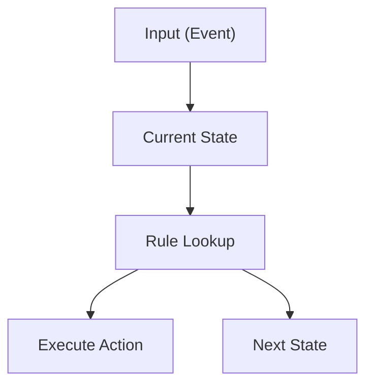
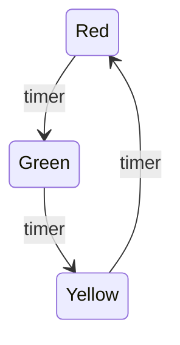
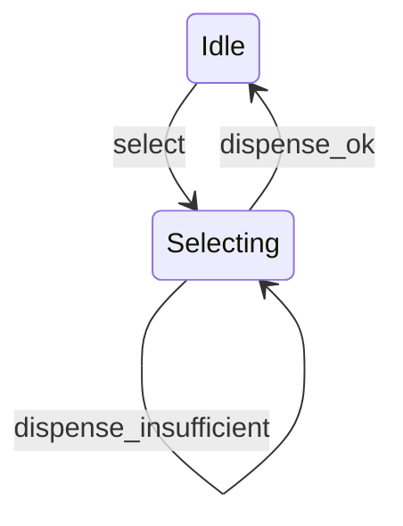
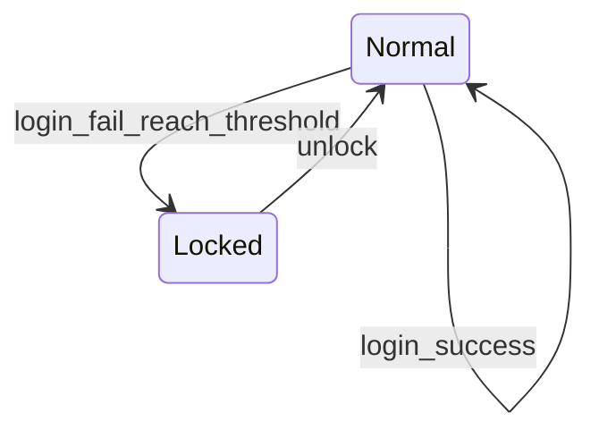
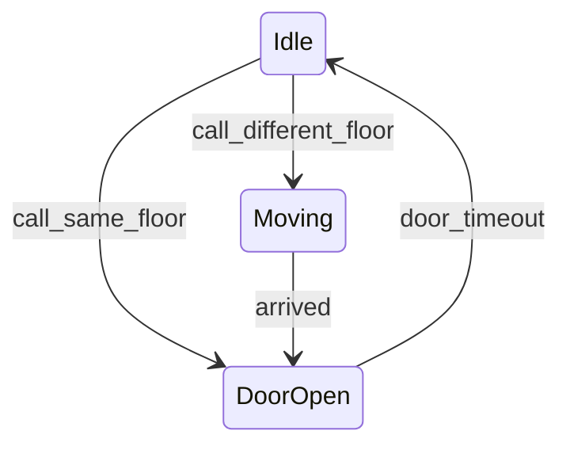
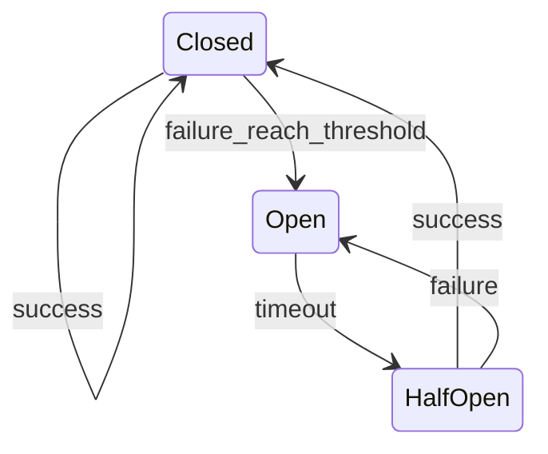
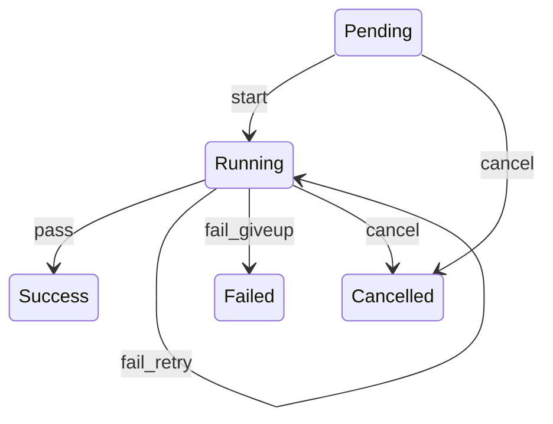
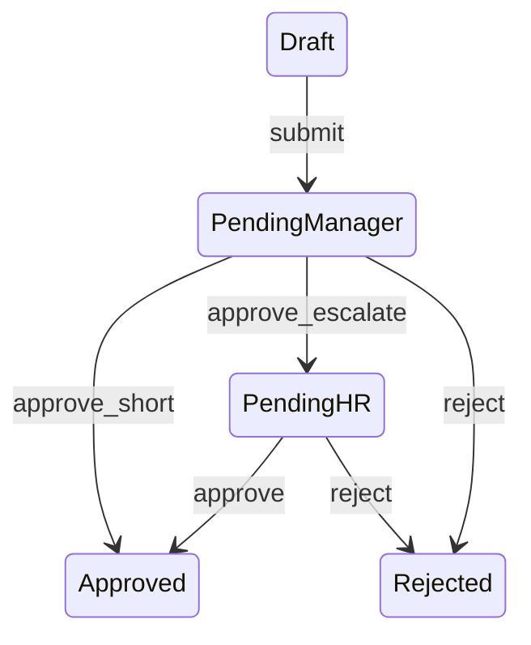
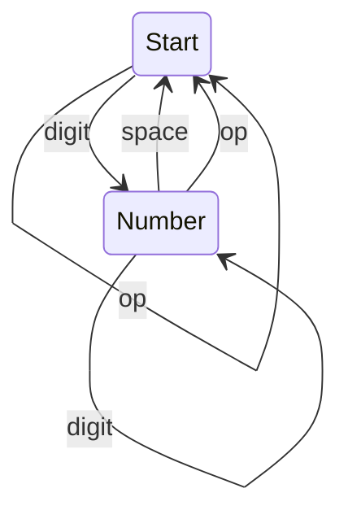

# "状态 + 规则表"——一种普适的软件设计心智模式

## 一、先理解一个最重要的思想

很多人写程序时，大脑中的模型是：

```
输入

↓

if

↓

elif

↓

elif

↓

输出
```

程序越来越大以后：

```
if
    if
        if
            if
                ...
```

最终变成：

```
Spaghetti Code
```

为什么？

因为程序实际上维护的是：

> **条件（Condition）**

而不是：

> **状态（State）**

真正优秀的软件不是：

```
条件驱动（Condition Driven）
```

而是：

```
状态驱动（State Driven）
```

进一步就是：

```
状态
+
规则表
+
输入
```

程序本身几乎不用写 if。

---

# 二、什么叫"状态"？

状态(State)

表示：

> **系统当前所处的位置。**

例如：

人：

```
睡觉

学习

工作

吃饭
```

TCP：

```
LISTEN

SYN_SENT

ESTABLISHED

FIN_WAIT
```

TextFSM：

```
Start

Interface

Route

ACL
```

订单：

```
待付款

待发货

运输中

已完成
```

播放器：

```
Stop

Play

Pause
```

一个系统任何时刻：

```
只能处于一个状态
```

这就是状态(State)。

---

## 状态识别三原则

不是所有"标记"都值得升级为状态。一个"标记"要不要设计成状态，看它是否同时满足下面三条：

**第一：互斥性（Mutually Exclusive）**

任何时刻只能处于其中一个，不能同时处于两个。

```
Play 和 Pause 不能同时为真
```

**第二：穷尽性（Exhaustive）**

所有可能的情况都必须被状态集合覆盖，不允许出现"没有对应状态"的情况。

```
播放器只有 Stop / Play / Pause 三个状态

不存在第四种"说不清楚"的情况
```

**第三：有限性（Finite）**

状态数量必须是有限的、可枚举的，这样才能画出一张规则表。

```
TCP 状态是 11 个，不是"无穷多个"
```

三条同时满足，才值得单独抽出一个"状态"概念；只满足一两条，往往说明它只是一个普通变量，不需要上升为状态。

---

## 常见误区：把状态藏进多个布尔变量里

很多程序不是没有状态，而是把状态藏起来了——藏进了一堆互相纠缠的布尔变量。

例如订单系统，很多人会这样写：

```python
is_paid = False
is_shipped = False
is_cancelled = False
```

看起来很直观，但问题在于：

```
3 个布尔变量

↓

2 的 3 次方 = 8 种组合
```

而业务上真正合法的组合可能只有 4、5 种，例如：

```
is_shipped=True 且 is_paid=False

↓

理论上不应该存在（没付款怎么发货？）

但代码没有任何机制阻止这种组合出现
```

这就是"隐式状态"的危害：

> **状态其实一直都在，只是被拆散藏进了多个布尔变量的组合里，导致非法组合无法被禁止。**

正确做法是把它们收敛成**一个**状态变量：

```python
from enum import Enum

class OrderState(Enum):
    NEW = "NEW"
    PAID = "PAID"
    SHIPPED = "SHIPPED"
    CANCELLED = "CANCELLED"
    FINISHED = "FINISHED"

state = OrderState.NEW
```

现在：

```
state 只能是 5 个值中的一个

不存在"半发货半没付款"这种非法组合
```

判断标准很简单：

> **如果你发现自己在用多个布尔变量的组合来表达"当前处于哪个阶段"，那说明这里缺了一个真正的状态变量。**

---

# 三、什么叫规则表？

规则就是：

```
当前状态
+
输入
↓

动作(Action)

↓

下一个状态
```

即：

```
(State, Event)
        ↓
(Action, NextState)
```

例如：

```
当前：

Play

输入：

Pause按钮

↓

执行：

暂停视频

↓

进入：

Pause
```

规则写成表：

|Current|Input|Action|Next|
|--------|------|------|------|
|Play|Pause|pause()|Pause|
|Pause|Play|resume()|Play|

是不是比：

```
if
elif
elif
```

清晰很多？

---

## 规则的正式结构

再往深一层看，一条规则其实是一个四元组：

```
(State, Event, Guard)
          ↓
   (Action, NextState)
```

- **State**：当前状态
- **Event**：当前输入
- **Guard**（可选）：附加条件，是否满足才允许这条转换发生
- **Action**：转换时执行的动作
- **NextState**：转换后进入的状态

写成 Python 的字典形式就是：

```python
rules = {
    (State, Event): [(Guard, Action, NextState), ...],
}
```

`Guard` 是为了解决一个现实问题：同一个 `(State, Event)`，在不同条件下可能走向不同的分支。例如"投币够了才能出货，不够就提示还差多少"——这两种结果对应同一个 `(Selecting, dispense)`，区别只在于金额是否足够。

解决办法不是写 if，而是把候选规则做成一个**按优先级排列的列表**：查表时从上到下找第一个 `Guard` 通过（或 `Guard` 为空）的规则执行。这样"分支"仍然是数据，而不是代码里的 if。

## 非法转换是默认值，而不是异常

规则表里没写的 `(State, Event)` 组合，应该被当成**默认非法**，而不是"什么都不做，静默忽略"。

```
表里没有的组合

↓

不是"忽略"

而是"设计者根本没考虑过这种情况"
```

如果程序遇到未覆盖的组合就静默放过，bug 会一直潜伏到很久以后才爆发；如果程序遇到未覆盖的组合就报错或拒绝，问题会在第一时间暴露。这也是本文后面"规则表完整性自检"会用到的核心原则。

## 通配符：从任意状态都能触发的转换

有些事件不管当前处于哪个状态都应该生效，例如"取消"、"复位"、"报错退出"。如果给每个状态都单独写一条规则，会有大量重复：

```
(Draft, cancel)      -> Cancelled
(Running, cancel)    -> Cancelled
(Paused, cancel)     -> Cancelled
(Reviewing, cancel)  -> Cancelled
...
```

更好的做法是引入一个特殊的"任意状态"标记（记作 `ANY`），查表时先查具体状态，查不到再退化到 `ANY`：

```
(ANY, cancel) -> Cancelled
```

这样"任意状态都能取消"这一条业务规则，只需要写一行。

## 规则表同时是规格、实现和文档

表驱动设计最大的价值在于：

```
业务人员看表格

↓

就能理解系统行为（规格）

程序直接查这张表

↓

就是完整实现（实现）

新人看这张表

↓

不用读代码也能搞懂系统（文档）
```

规格、实现、文档，三者合一，不会走样、不会脱节。这是"if/elif 堆出来的代码"永远做不到的事情。

---

# 四、真正的软件其实就是查表

程序真正干的事情其实非常简单：

```
当前状态

↓

收到输入

↓

查规则表

↓

执行动作

↓

更新状态
```

就是：

```
Lookup Table
```

不是：

```
if
```

---

# 五、统一抽象

几乎所有状态机都能抽象成：

```
                 Input(Event)

                      │

                      ▼

             +----------------+
             | Current State  |
             +----------------+
                      │

                      ▼
              Rule Lookup
                      │

         ┌────────────┴────────────┐
         ▼                         ▼
     Execute Action          Next State
```

等价的 Mermaid 版本（内容一旦有分支，用 Mermaid 会比纯 ASCII 更清楚）：



所以：

状态机真正的数据结构就是：

```
(state,event)

↓

rule
```

---

# 六、通用状态机引擎

前面一直在讲道理，现在把"查表"这件事写成一段可以在所有场景里复用的引擎代码。它只做一件事：**收到事件 → 查表 → 校验 Guard → 执行 Action → 更新状态**，不掺杂任何具体业务：

```python
class RuleTableFSM:
    ANY = "ANY"

    def __init__(self, initial, rules, on_illegal=None):
        self.state = initial
        self.rules = rules          # {(state, event): [(guard, action, next_state), ...]}
        self.on_illegal = on_illegal
        self.history = [initial]

    def _candidates(self, event):
        return self.rules.get((self.state, event)) or self.rules.get((self.ANY, event))

    def fire(self, event, **ctx):
        candidates = self._candidates(event)

        if not candidates:
            if self.on_illegal:
                return self.on_illegal(self.state, event)
            raise ValueError(f"非法转换: state={self.state} event={event}")

        for guard, action, next_state in candidates:
            if guard is None or guard(ctx):
                result = action(ctx) if action else None
                self.state = next_state
                self.history.append(next_state)
                return result

        raise ValueError(f"所有 Guard 均拒绝: state={self.state} event={event}")
```

几个关键点：

- `rules` 的键是 `(state, event)`，值是一个**按顺序尝试的候选列表**——对应前面讲的"Guard 决定分支"。
- 查不到具体状态的规则时，退化到 `(ANY, event)`——对应前面讲的"通配符"。
- 查不到任何规则时，默认认为是非法转换并抛异常，除非显式传入 `on_illegal` 兜底——对应前面讲的"非法转换是默认值"。
- `fire()` 里没有一行业务 if，所有的分支都来自 `rules` 这份数据。

### 用引擎重跑"自动门"，验证等价性

用这个引擎重新实现最开始的自动门例子：

```python
rules = {
    ("Closed", "button"): [(None, lambda ctx: print("开始开门"), "Opening")],
    ("Opening", "opened"): [(None, lambda ctx: print("门已打开"), "Opened")],
    ("Opened", "timeout"): [(None, lambda ctx: print("开始关门"), "Closing")],
    ("Closing", "closed"): [(None, lambda ctx: print("门已关闭"), "Closed")],
}

door = RuleTableFSM("Closed", rules)

for e in ["button", "opened", "timeout", "closed"]:
    door.fire(e)
    print("Current:", door.state)
```

输出：

```
开始开门
Current: Opening
门已打开
Current: Opened
开始关门
Current: Closing
门已关闭
Current: Closed
```

和后面"基础场景"里手写 `for + dict` 循环的输出**完全一样**。这说明：引擎只是把手写循环封装成了一个方法，并补上了 Guard、通配符、非法转换三项能力，核心思想——查表——完全没有变。

从这里开始，后面的进阶场景都会复用这个 `RuleTableFSM`，不再重新发明轮子。

---

# 七、基础场景（最小实现）

这一节沿用最原始的写法：手写 `dict` + `for` 循环，不引入任何引擎，用来建立最朴素的直觉——"状态机就是查表"。

## 示例1 自动门（Automatic Door）

状态图：

```
Closed

↓

按钮

↓

Opening

↓

Opened

↓

Timeout

↓

Closing

↓

Closed
```

规则表：

|State|Event|Action|Next|
|------|------|------|------|
|Closed|button|open()|Opening|
|Opening|opened|stop()|Opened|
|Opened|timeout|close()|Closing|
|Closing|closed|stop()|Closed|

Python 实现：

```python
rules = {
    ("Closed", "button"): ("Opening", "开始开门"),
    ("Opening", "opened"): ("Opened", "门已打开"),
    ("Opened", "timeout"): ("Closing", "开始关门"),
    ("Closing", "closed"): ("Closed", "门已关闭"),
}

state = "Closed"

events = [
    "button",
    "opened",
    "timeout",
    "closed"
]

for e in events:
    key = (state, e)

    if key in rules:
        state, action = rules[key]
        print(action)
        print("Current:", state)
```

输出：

```
开始开门
Current Opening
门已打开
Current Opened
开始关门
Current Closing
门已关闭
Current Closed
```

整个程序没有业务 if。

---

## 示例2 TCP 三次握手

状态：

```
CLOSED

↓

LISTEN

↓

SYN_RCVD

↓

ESTABLISHED
```

规则：

```python
rules = {
    ("LISTEN", "SYN"): ("SYN_RCVD", "Send SYN+ACK"),
    ("SYN_RCVD", "ACK"): ("ESTABLISHED", "Connection Established"),
}

state = "LISTEN"

inputs = ["SYN", "ACK"]

for packet in inputs:
    state, action = rules[(state, packet)]
    print(action)
    print("Current:", state)
```

输出：

```
Send SYN+ACK
Current: SYN_RCVD
Connection Established
Current: ESTABLISHED
```

Linux TCP 实际就是这种思想，只不过状态更多（十几个）。

---

## 示例3 订单系统

状态：

```
NEW

PAID

SHIPPED

FINISHED
```

规则：

```python
rules = {
    ("NEW", "pay"): ("PAID", "支付成功"),
    ("PAID", "ship"): ("SHIPPED", "开始发货"),
    ("SHIPPED", "receive"): ("FINISHED", "订单完成"),
}

state = "NEW"

events = ["pay", "ship", "receive"]

for e in events:
    state, action = rules[(state, e)]
    print(action)
    print(state)
```

这就是电商后台真正干的事情。

---

## 示例4 TextFSM 的最小实现

输入：

```text
Gi0 up
Gi1 down
```

规则：

```python
import re

rules = [
    (
        "Start",
        re.compile(r"(\S+)\s+(up|down)"),
        "Record",
        "Start"
    )
]

state = "Start"

text = """
Gi0 up
Gi1 down
"""

records = []

for line in text.strip().splitlines():

    for s, regex, action, next_state in rules:

        if s != state:
            continue

        m = regex.match(line)

        if m:
            records.append({
                "if": m.group(1),
                "status": m.group(2)
            })

            state = next_state
            break

print(records)
```

是不是就是：

```
State

↓

Regex

↓

Action

↓

Next State
```

---

## 示例5 HTTP 请求解析器（极简版）

HTTP：

```
GET /

Host:

Header

Body
```

每一部分都有不同规则。

```python
state = "REQUEST"

rules = {
    ("REQUEST", "line"): ("HEADER", "解析请求行"),
    ("HEADER", "header"): ("HEADER", "保存Header"),
    ("HEADER", "blank"): ("BODY", "开始Body"),
    ("BODY", "data"): ("BODY", "读取Body"),
}

events = [
    "line",
    "header",
    "header",
    "blank",
    "data",
    "data",
]

for e in events:
    state, action = rules[(state, e)]
    print(action)
    print(state)
```

真正的 HTTP Parser（如 llhttp）本质就是大型状态机。

---

# 八、进阶场景（Guard + 通配符 + 完整业务）

这一节全部基于第六节的 `RuleTableFSM` 引擎，逐步引入 Guard 条件、通配符、上下文数据、非法转换处理，覆盖 8 个不同复杂度的工程场景。

## 示例6 交通信号灯（最简定时驱动）

状态图：



规则表：

|State|Event|Action|Next|
|------|------|------|------|
|Red|timer|绿灯亮起|Green|
|Green|timer|黄灯亮起|Yellow|
|Yellow|timer|红灯亮起|Red|

Python 实现：

```python
rules = {
    ("Red", "timer"): [(None, lambda ctx: print("绿灯亮起"), "Green")],
    ("Green", "timer"): [(None, lambda ctx: print("黄灯亮起"), "Yellow")],
    ("Yellow", "timer"): [(None, lambda ctx: print("红灯亮起"), "Red")],
}

light = RuleTableFSM("Red", rules)

for _ in range(5):
    print("Current:", light.state)
    light.fire("timer")
```

输出：

```
Current: Red
绿灯亮起
Current: Green
黄灯亮起
Current: Yellow
红灯亮起
Current: Red
绿灯亮起
Current: Green
黄灯亮起
```

没有分支、没有数据，只是最纯粹的循环查表，用来建立"引擎怎么跑起来"的直觉。

---

## 示例7 自动售货机（Guard 条件）

状态图：



规则表：

|State|Event|Guard|Action|Next|
|------|------|------|------|------|
|Idle|select|-|记录单价|Selecting|
|Selecting|insert_coin|-|累计金额|Selecting|
|Selecting|dispense|金额 >= 单价|出货、找零|Idle|
|Selecting|dispense|金额 < 单价|提示还差多少|Selecting|

关键点：同一个 `(Selecting, dispense)` 对应两条规则，靠 Guard 决定走哪一条——不需要写一行 if。

```python
class VendingMachine:
    def __init__(self, price):
        self.price = price
        self.inserted = 0


def select_item(ctx):
    print(f"已选择商品，单价 {ctx['vm'].price} 元")


def insert_coin(ctx):
    vm = ctx["vm"]
    vm.inserted += ctx["amount"]
    print(f"已投入 {vm.inserted} 元，还需 {max(vm.price - vm.inserted, 0)} 元")


def dispense_ok(ctx):
    vm = ctx["vm"]
    change = vm.inserted - vm.price
    print(f"出货成功，找零 {change} 元")
    vm.inserted = 0


def dispense_insufficient(ctx):
    vm = ctx["vm"]
    print(f"余额不足，还需投入 {vm.price - vm.inserted} 元")


rules = {
    ("Idle", "select"): [(None, select_item, "Selecting")],
    ("Selecting", "insert_coin"): [(None, insert_coin, "Selecting")],
    ("Selecting", "dispense"): [
        (lambda ctx: ctx["vm"].inserted >= ctx["vm"].price, dispense_ok, "Idle"),
        (None, dispense_insufficient, "Selecting"),
    ],
}

vm = VendingMachine(price=5)
machine = RuleTableFSM("Idle", rules)

machine.fire("select", vm=vm)
machine.fire("insert_coin", vm=vm, amount=2)
machine.fire("dispense", vm=vm)
machine.fire("insert_coin", vm=vm, amount=3)
machine.fire("dispense", vm=vm)
print("Current:", machine.state)
```

输出：

```
已选择商品，单价 5 元
已投入 2 元，还需 3 元
余额不足，还需投入 3 元
已投入 5 元，还需 0 元
出货成功，找零 0 元
Current: Idle
```

---

## 示例8 登录失败锁定（状态 + 计数器 + 通配符）

状态图：



`unlock` 实际用通配符 `ANY -> Normal` 实现，图中为了直观简化成 `Locked -> Normal`。

规则表：

|State|Event|Guard|Action|Next|
|------|------|------|------|------|
|Normal|login_fail|失败次数 >= 阈值|锁定账户|Locked|
|Normal|login_fail|失败次数 < 阈值|提示失败次数|Normal|
|Normal|login_success|-|登录成功、清零计数|Normal|
|ANY|unlock|-|解锁、清零计数|Normal|

这里有一个容易忽略但很重要的设计原则：**计数属于业务上下文，不属于状态机本身**。失败次数在事件产生之前（调用 `fire` 之前）就已经增加好了，Guard 只负责读取，不做任何有副作用的修改：

```python
class LoginAttempt:
    def __init__(self, threshold=3):
        self.count = 0
        self.threshold = threshold


def fail_once(ctx):
    la = ctx["la"]
    print(f"登录失败，第 {la.count} 次")


def lock_account(ctx):
    la = ctx["la"]
    print(f"连续失败 {la.count} 次，账户已锁定")


def reset_and_greet(ctx):
    ctx["la"].count = 0
    print("登录成功")


def unlock(ctx):
    ctx["la"].count = 0
    print("账户已解锁")


def reject(state, event):
    print(f"操作被拒绝: 当前处于 {state}，无法处理 {event}")


rules = {
    ("Normal", "login_fail"): [
        (lambda ctx: ctx["la"].count >= ctx["la"].threshold, lock_account, "Locked"),
        (None, fail_once, "Normal"),
    ],
    ("Normal", "login_success"): [(None, reset_and_greet, "Normal")],
    (RuleTableFSM.ANY, "unlock"): [(None, unlock, "Normal")],
}


def try_login_fail(machine, la):
    la.count += 1
    machine.fire("login_fail", la=la)


la = LoginAttempt(threshold=3)
machine = RuleTableFSM("Normal", rules, on_illegal=reject)

for _ in range(2):
    try_login_fail(machine, la)
    print("Current:", machine.state)

try_login_fail(machine, la)
print("Current:", machine.state)

machine.fire("login_success", la=la)
machine.fire("unlock", la=la)
print("Current:", machine.state)
```

输出：

```
登录失败，第 1 次
Current: Normal
登录失败，第 2 次
Current: Normal
连续失败 3 次，账户已锁定
Current: Locked
操作被拒绝: 当前处于 Locked，无法处理 login_success
账户已解锁
Current: Normal
```

注意第 4 步：账户已锁定后尝试 `login_success`，规则表里没有 `(Locked, login_success)`，也没有 `(ANY, login_success)`，于是走到了 `on_illegal` 兜底逻辑——这正是第三节"非法转换是默认值"的实际效果。紧接着 `unlock` 命中了 `(ANY, unlock)` 通配符规则，无论当前是 `Normal` 还是 `Locked` 都能生效。

---

## 示例9 电梯调度器（副作用动作 + 分支跳过中间状态）

状态图：



规则表：

|State|Event|Guard|Action|Next|
|------|------|------|------|------|
|Idle|call|目标楼层 == 当前楼层|直接开门|DoorOpen|
|Idle|call|目标楼层 != 当前楼层|开始移动|Moving|
|Moving|arrived|-|到达、开门|DoorOpen|
|DoorOpen|door_timeout|-|关门、待命|Idle|

```python
class Elevator:
    def __init__(self):
        self.floor = 1
        self.target = 1


def start_move(ctx):
    e = ctx["e"]
    e.target = ctx["floor"]
    print(f"电梯从 {e.floor} 楼出发，前往 {e.target} 楼")


def already_there(ctx):
    e = ctx["e"]
    print(f"电梯已在 {e.floor} 楼，直接开门")


def arrive(ctx):
    e = ctx["e"]
    e.floor = e.target
    print(f"电梯到达 {e.floor} 楼，开门")


def close_door(ctx):
    print("门已关闭，电梯待命")


rules = {
    ("Idle", "call"): [
        (lambda ctx: ctx["floor"] == ctx["e"].floor, already_there, "DoorOpen"),
        (None, start_move, "Moving"),
    ],
    ("Moving", "arrived"): [(None, arrive, "DoorOpen")],
    ("DoorOpen", "door_timeout"): [(None, close_door, "Idle")],
}

e = Elevator()
machine = RuleTableFSM("Idle", rules)

machine.fire("call", e=e, floor=4)
print("Current:", machine.state)

machine.fire("arrived", e=e)
print("Current:", machine.state)

machine.fire("door_timeout", e=e)
print("Current:", machine.state)

machine.fire("call", e=e, floor=4)
print("Current:", machine.state)
```

输出：

```
电梯从 1 楼出发，前往 4 楼
Current: Moving
电梯到达 4 楼，开门
Current: DoorOpen
门已关闭，电梯待命
Current: Idle
电梯已在 4 楼，直接开门
Current: DoorOpen
```

最后一次呼叫电梯时，目标楼层与当前楼层相同，Guard 命中了"直接开门"这条规则，直接跳过了 `Moving` 状态——这说明"路径"本身也是由规则表决定的，不是硬编码的固定流程。

---

## 示例10 断路器模式（Circuit Breaker）

这是工程实践中最常见的"状态 + 规则表"落地案例之一，用于服务限流熔断。

状态图：



规则表：

|State|Event|Guard|Action|Next|
|------|------|------|------|------|
|Closed|failure|失败次数 >= 阈值|熔断打开|Open|
|Closed|failure|失败次数 < 阈值|记录失败|Closed|
|Closed|success|-|保持关闭|Closed|
|Open|timeout|-|进入半开、放行试探请求|HalfOpen|
|HalfOpen|success|-|恢复关闭|Closed|
|HalfOpen|failure|-|重新打开|Open|

```python
class Breaker:
    def __init__(self, threshold=3):
        self.fail_count = 0
        self.threshold = threshold


def record_failure(ctx):
    b = ctx["b"]
    print(f"请求失败，累计失败 {b.fail_count} 次")


def trip_open(ctx):
    b = ctx["b"]
    print(f"连续失败 {b.fail_count} 次，熔断器打开，拒绝后续请求")


def record_success(ctx):
    ctx["b"].fail_count = 0
    print("请求成功，熔断器保持关闭")


def half_open(ctx):
    print("冷却时间到，进入半开状态，尝试放行一个请求")


def recover(ctx):
    ctx["b"].fail_count = 0
    print("试探请求成功，熔断器恢复关闭")


def re_trip(ctx):
    print("试探请求仍然失败，重新回到打开状态")


rules = {
    ("Closed", "failure"): [
        (lambda ctx: ctx["b"].fail_count >= ctx["b"].threshold, trip_open, "Open"),
        (None, record_failure, "Closed"),
    ],
    ("Closed", "success"): [(None, record_success, "Closed")],
    ("Open", "timeout"): [(None, half_open, "HalfOpen")],
    ("HalfOpen", "success"): [(None, recover, "Closed")],
    ("HalfOpen", "failure"): [(None, re_trip, "Open")],
}


def call_and_fail(machine, b):
    b.fail_count += 1
    machine.fire("failure", b=b)


b = Breaker(threshold=3)
machine = RuleTableFSM("Closed", rules)

for _ in range(3):
    call_and_fail(machine, b)
    print("Current:", machine.state)

machine.fire("timeout", b=b)
print("Current:", machine.state)

machine.fire("failure", b=b)
print("Current:", machine.state)

machine.fire("timeout", b=b)
machine.fire("success", b=b)
print("Current:", machine.state)
```

输出：

```
请求失败，累计失败 1 次
Current: Closed
请求失败，累计失败 2 次
Current: Closed
连续失败 3 次，熔断器打开，拒绝后续请求
Current: Open
冷却时间到，进入半开状态，尝试放行一个请求
Current: HalfOpen
试探请求仍然失败，重新回到打开状态
Current: Open
冷却时间到，进入半开状态，尝试放行一个请求
试探请求成功，熔断器恢复关闭
Current: Closed
```

`Closed → Open → HalfOpen → Open → HalfOpen → Closed` 这条完整的震荡路径，全部由 6 条规则决定，没有一行是硬编码的流程控制。

---

## 示例11 CI/CD 流水线（重试循环 + 通配符取消）

状态图：



规则表：

|State|Event|Guard|Action|Next|
|------|------|------|------|------|
|Pending|start|-|开始执行|Running|
|Running|pass|-|流水线成功|Success|
|Running|fail|重试次数 < 上限|准备重试|Running|
|Running|fail|重试次数 >= 上限|判定失败|Failed|
|ANY|cancel|-|终止任务|Cancelled|

```python
class Job:
    def __init__(self, max_retries=2):
        self.attempts = 0
        self.max_retries = max_retries


def start_run(ctx):
    print("开始执行流水线")


def succeed(ctx):
    print("流水线执行成功")


def retry(ctx):
    j = ctx["job"]
    print(f"执行失败，第 {j.attempts} 次重试")


def give_up(ctx):
    print("重试次数耗尽，流水线失败")


def cancel(ctx):
    print(f"流水线已取消（原状态: {ctx['machine'].state}）")


rules = {
    ("Pending", "start"): [(None, start_run, "Running")],
    ("Running", "pass"): [(None, succeed, "Success")],
    ("Running", "fail"): [
        (lambda ctx: ctx["job"].attempts < ctx["job"].max_retries, retry, "Running"),
        (None, give_up, "Failed"),
    ],
    (RuleTableFSM.ANY, "cancel"): [(None, cancel, "Cancelled")],
}

job = Job(max_retries=2)
machine = RuleTableFSM("Pending", rules)

machine.fire("start", job=job, machine=machine)
print("Current:", machine.state)

job.attempts += 1
machine.fire("fail", job=job, machine=machine)
print("Current:", machine.state)

job.attempts += 1
machine.fire("fail", job=job, machine=machine)
print("Current:", machine.state)

print("---")

job2 = Job(max_retries=2)
machine2 = RuleTableFSM("Pending", rules)
machine2.fire("start", job=job2, machine=machine2)
machine2.fire("cancel", job=job2, machine=machine2)
print("Current:", machine2.state)
```

输出：

```
开始执行流水线
Current: Running
执行失败，第 1 次重试
Current: Running
重试次数耗尽，流水线失败
Current: Failed
---
开始执行流水线
流水线已取消（原状态: Running）
Current: Cancelled
```

注意 `cancel` 这个动作里读取的是 `ctx["machine"].state`，也就是**转换发生前**的状态——因为引擎里 `action` 是在 `self.state` 被覆盖之前执行的。把 `machine` 传进 `ctx` 里，就能在动作里"看到"自己即将离开的状态。

---

## 示例12 请假审批工作流（多角色状态机）

状态图：



规则表：

|State|Event|Guard|Action|Next|
|------|------|------|------|------|
|Draft|submit|-|提交申请|PendingManager|
|PendingManager|approve|天数 <= 3|经理直接批准|Approved|
|PendingManager|approve|天数 > 3|转交 HR|PendingHR|
|PendingManager|reject|-|经理拒绝|Rejected|
|PendingHR|approve|-|HR 批准|Approved|
|PendingHR|reject|-|HR 拒绝|Rejected|

```python
class LeaveRequest:
    def __init__(self, days):
        self.days = days


def submit(ctx):
    print(f"已提交请假申请（{ctx['req'].days} 天），等待经理审批")


def manager_auto_approve(ctx):
    print("请假天数 <= 3 天，经理直接批准")


def manager_escalate(ctx):
    print("请假天数 > 3 天，转交 HR 审批")


def manager_reject(ctx):
    print("经理已拒绝申请")


def hr_approve(ctx):
    print("HR 已批准，申请通过")


def hr_reject(ctx):
    print("HR 已拒绝，申请驳回")


rules = {
    ("Draft", "submit"): [(None, submit, "PendingManager")],
    ("PendingManager", "approve"): [
        (lambda ctx: ctx["req"].days <= 3, manager_auto_approve, "Approved"),
        (None, manager_escalate, "PendingHR"),
    ],
    ("PendingManager", "reject"): [(None, manager_reject, "Rejected")],
    ("PendingHR", "approve"): [(None, hr_approve, "Approved")],
    ("PendingHR", "reject"): [(None, hr_reject, "Rejected")],
}

req1 = LeaveRequest(days=2)
wf1 = RuleTableFSM("Draft", rules)
wf1.fire("submit", req=req1)
wf1.fire("approve", req=req1)
print("Current:", wf1.state)

print("---")

req2 = LeaveRequest(days=5)
wf2 = RuleTableFSM("Draft", rules)
wf2.fire("submit", req=req2)
wf2.fire("approve", req=req2)
print("Current:", wf2.state)
wf2.fire("approve", req=req2)
print("Current:", wf2.state)
```

输出：

```
已提交请假申请（2 天），等待经理审批
请假天数 <= 3 天，经理直接批准
Current: Approved
---
已提交请假申请（5 天），等待经理审批
请假天数 > 3 天，转交 HR 审批
Current: PendingHR
HR 已批准，申请通过
Current: Approved
```

两次提交走了完全不同的路径（一次两步到 `Approved`，一次三步经过 `PendingHR`），但用的是同一份规则表——这正是绝大多数审批类业务系统的真实写法。

---

## 示例13 表达式词法分析器（字符级状态机）

前面示例4的 TextFSM 是**逐行**扫描；这里换成**逐字符**扫描，证明同一套心智模式在更细的粒度上依然成立——这也是真正的编译器前端（Lexer）在做的事情。

目标：把 `"12 + 34 * 5"` 切分成 Token 序列。

状态图：



规则表：

|State|CharType|Action|Next|
|------|------|------|------|
|Start|digit|开始记录数字|Number|
|Number|digit|继续记录数字|Number|
|Number|space|产出 NUMBER，清空缓冲|Start|
|Number|op|产出 NUMBER + OP，清空缓冲|Start|
|Start|space|忽略|Start|
|Start|op|产出 OP|Start|

```python
OPERATORS = set("+-*/")


def char_type(ch):
    if ch is None:
        return "end"
    if ch.isdigit():
        return "digit"
    if ch.isspace():
        return "space"
    if ch in OPERATORS:
        return "op"
    raise ValueError(f"未知字符: {ch}")


def begin_number(ctx):
    ctx["buf"].append(ctx["ch"])


def append_number(ctx):
    ctx["buf"].append(ctx["ch"])


def flush_number(ctx):
    if ctx["buf"]:
        ctx["tokens"].append(("NUMBER", "".join(ctx["buf"])))
        ctx["buf"].clear()


def flush_number_and_emit_op(ctx):
    flush_number(ctx)
    ctx["tokens"].append(("OP", ctx["ch"]))


def emit_op(ctx):
    ctx["tokens"].append(("OP", ctx["ch"]))


def noop(ctx):
    pass


rules = {
    ("Start", "digit"): [(None, begin_number, "Number")],
    ("Number", "digit"): [(None, append_number, "Number")],
    ("Number", "space"): [(None, flush_number, "Start")],
    ("Number", "op"): [(None, flush_number_and_emit_op, "Start")],
    ("Start", "space"): [(None, noop, "Start")],
    ("Start", "op"): [(None, emit_op, "Start")],
    ("Number", "end"): [(None, flush_number, "Start")],
    ("Start", "end"): [(None, noop, "Start")],
}


def tokenize(text):
    lexer = RuleTableFSM("Start", rules)
    tokens, buf = [], []

    for ch in text:
        lexer.fire(char_type(ch), ch=ch, tokens=tokens, buf=buf)

    lexer.fire("end", ch=None, tokens=tokens, buf=buf)
    return tokens


tokens = tokenize("12 + 34 * 5")
print(tokens)
```

输出：

```
[('NUMBER', '12'), ('OP', '+'), ('NUMBER', '34'), ('OP', '*'), ('NUMBER', '5')]
```

TextFSM 是"行级状态机"，Lexer 是"字符级状态机"——粒度不同，但都是"当前状态 + 当前输入 → 查表 → 动作 + 下一状态"这同一句话。

---

# 九、为什么这种模式如此强大？

因为它把程序拆成了三个独立维度：

```
状态(State)

规则(Rule)

动作(Action)
```

而不是：

```
if

↓

业务

↓

状态

↓

输出
```

这叫：

> **解耦（Decoupling）**

修改规则：

不用改代码。

新增状态：

不用改已有状态。

新增事件：

增加规则即可。

---

# 十、为什么 Linux、DPDK、编译器都喜欢这种模式？

因为它满足三个要求：

第一：

状态有限。

例如：

```
TCP

11个状态
```

第二：

输入有限。

例如：

```
SYN

ACK

FIN
```

第三：

规则有限。

例如：

```
LISTEN+SYN

↓

SYN_RCVD
```

于是：

```
状态 × 输入

↓

查表
```

复杂度立即下降。

---

# 十一、这种模式对应的心智模型

不要把程序理解成：

```
代码

↓

运行
```

应该理解成：

```
状态

+

输入

↓

查规则

↓

执行动作

↓

进入新状态
```

也就是说：

程序真正的 CPU 思维其实就是：

```
Current State

+

Current Input

↓

Lookup

↓

Action

↓

Next State
```

整个程序就是不断重复这一循环：

```
        +---------------------+
        |   Current State     |
        +----------+----------+
                   |
                   v
             Receive Event
                   |
                   v
        +---------------------+
        |    Rule Lookup      |
        +----------+----------+
                   |
        +----------+----------+
        |                     |
        v                     v
 Execute Action         Next State
        |                     |
        +----------+----------+
                   |
                   v
            Continue Loop
```

---

# 十二、从"状态 + 规则表"再上升一个层次

这一模式实际上是一种统一的软件抽象，可以覆盖大量看似不同的系统：

| 系统 | 状态（State） | 输入（Event） | 动作（Action） |
|------|---------------|---------------|----------------|
| TextFSM | Start、Interface、Route | 当前文本行 | 提取字段、Record、状态迁移 |
| TCP 协议栈 | LISTEN、SYN_SENT、ESTABLISHED | 收到 TCP 报文 | 发送响应报文、更新连接状态 |
| HTTP Parser | REQUEST、HEADER、BODY | 字符流或 Token | 解析字段、保存 Header、切换阶段 |
| 电商订单 | NEW、PAID、SHIPPED | 支付、发货、签收 | 更新订单、发送通知 |
| UI 按钮 | Normal、Hover、Pressed | 鼠标移动、点击 | 重绘界面、触发事件 |
| 游戏 AI | Patrol、Chase、Attack | 看见敌人、距离变化 | 移动、攻击、逃跑 |
| 编译器 Lexer | Start、Identifier、Number | 当前字符 | 构造 Token、切换状态 |
| Linux 网络协议栈 | 各协议处理阶段 | 收到数据包 | 查表、分发、协议处理 |
| 交通信号灯 | Red、Green、Yellow | 定时器 timer | 切换灯色 |
| 自动售货机 | Idle、Selecting | select、insert_coin、dispense | 校验金额、找零、出货 |
| 登录失败锁定 | Normal、Locked | login_fail、login_success、unlock | 计数、锁定、重置 |
| 电梯调度器 | Idle、Moving、DoorOpen | call、arrived、door_timeout | 移动、开关门 |
| 断路器 Circuit Breaker | Closed、Open、HalfOpen | success、failure、timeout | 熔断、恢复、拒绝请求 |
| CI/CD 流水线 | Pending、Running、Success、Failed、Cancelled | start、pass、fail、cancel | 执行、重试、终止 |
| 请假审批工作流 | Draft、PendingManager、PendingHR、Approved、Rejected | submit、approve、reject | 审批、转交、驳回 |
| 表达式词法分析器 | Start、Number | 字符类型（digit/space/op/end） | 记录字符、生成 Token |

因此，可以把它提升为一种普适的工程思维：

> **不要直接思考"要写哪些 if/else"，而是先识别系统有哪些稳定的状态（State）、会接收哪些输入（Event）、需要执行哪些动作（Action），最后用规则表（Rule Table）描述它们之间的关系。程序只是一个执行规则的引擎，而不是规则本身。**

## 与 OOP State 设计模式的关系

本文用的是**数据驱动（字典/列表）**的表达方式：迁移逻辑集中在一张表里，程序本身几乎不用写分支。

经典的面向对象 **State 设计模式**则是把每个状态实现成一个类，迁移逻辑分散在各个类的方法里（可参考 [python/patterns/14_state.md](../python/patterns/14_state.md)）。

两者本质相同——都是"用状态消除条件判断"，区别只在于"迁移逻辑放在哪里"：

| 维度 | 表驱动（本文） | OOP State 模式 |
|------|----------------|-----------------|
| 迁移逻辑位置 | 集中在一张表里 | 分散在每个状态类里 |
| 新增状态 | 加一行/几行规则 | 新增一个类 |
| 每个状态的复杂逻辑 | 受限（只能挂 Action 函数） | 可以写任意复杂代码 |
| 可视化/可审查 | 表格一目了然 | 需要跳转多个文件才能看全 |
| 适用场景 | 状态数量多、规则清晰、需要配置化 | 每个状态都有大量独立、复杂的行为 |

工程实践中两者经常结合使用：用表驱动描述"合法迁移有哪些"，用普通函数或类方法承载"每个动作具体怎么做"——本文的 `Action` 参数本身就是一个可以指向任意复杂函数（甚至一个对象方法）的钩子。

掌握了这一心智模式，再学习 TextFSM、TCP 状态机、编译器、工作流引擎、事件驱动框架，甚至 Linux 内核中的许多子系统时，你会发现它们只是**状态、事件和规则表**在不同领域的具体实例。

---

# 十三、常见误区与自查清单

## 状态识别自查清单

设计一个"状态 + 规则表"系统之前，先问自己三个问题：

```
[ ] 我列出的这些状态，是否两两互斥？
    （不存在"同时处于两个状态"的情况）

[ ] 我列出的这些状态，是否穷尽了所有可能？
    （不存在"找不到对应状态"的输入）

[ ] 状态的数量是否有限、可枚举？
    （能画出一张完整的规则表，而不是无穷多种情况）
```

三条都满足，才值得画规则表；只满足一两条，很可能只是一个普通变量，不需要上升为"状态"。

## 规则表完整性自检

第三节提到"非法转换应该是默认值"，这句话可以直接写成代码：遍历所有 `(state, event)` 组合，找出规则表里没有覆盖、也没有被 `ANY` 兜底的单元格。

以示例10的断路器规则表为例（`rules` 就是示例10里定义的那份规则）：

```python
def check_completeness(states, events, rules):
    missing = []
    for s in states:
        for e in events:
            key = (s, e)
            if key not in rules and (RuleTableFSM.ANY, e) not in rules:
                missing.append(key)
    return missing


states = {"Closed", "Open", "HalfOpen"}
events = {"success", "failure", "timeout"}

missing = check_completeness(states, events, rules)
for m in sorted(missing):
    print("未覆盖:", m)
```

输出：

```
未覆盖: ('Closed', 'timeout')
未覆盖: ('HalfOpen', 'timeout')
未覆盖: ('Open', 'failure')
未覆盖: ('Open', 'success')
```

这 4 个组合确实是设计上"故意不处理"的——例如熔断器打开（`Open`）时请求会被直接拒绝，根本不会产生 `success`/`failure` 事件。但通过这份清单，我们能明确区分"故意忽略"和"真正遗漏"，而不是等程序在生产环境抛出 `KeyError` 才发现问题。这正是表驱动设计相比 if/elif 最大的工程价值之一：**遗漏是可以被枚举出来的，而不是靠运气发现的。**

## 什么时候不需要这种模式

表驱动不是银弹，下面几种情况直接用 if/else 反而更简单：

```
状态少于 3 个，且转换关系一次性、不会再变

只是一段线性流程，没有复用、没有配置化的需求

极端性能敏感的内层循环
（查表本身有额外开销，需要先 profile，再决定要不要引入）
```

判断标准很简单：如果画规则表比写 if/else 还费劲，那说明问题本身还没有复杂到需要这个模式。

---

# 十四、总结

"状态 + 规则表"并不仅仅是几个例子的堆砌，它是一套完整的软件设计心智模式：

1. **先识别状态，再识别规则**——状态要满足互斥、穷尽、有限三个条件，不要把状态藏进多个布尔变量的组合里。
2. **规则是一个四元组** `(State, Event, Guard) -> (Action, NextState)`——Guard 负责在同一输入下产生不同分支，通配符 `ANY` 负责"从任意状态都能触发"的转换，未覆盖的组合默认非法。
3. **程序的核心循环永远是同一句话**：当前状态 + 当前输入 → 查表 → 执行动作 → 更新状态。这句话可以直接写成一个几十行的通用引擎（`RuleTableFSM`），在所有场景里复用。
4. **13 个场景证明了同一套心智模式的普适性**：从最朴素的自动门、TCP 握手，到带 Guard 的售货机、断路器、CI/CD 流水线，再到字符级的词法分析器——状态数量、规则复杂度在变，但"查表"这件事从未改变。
5. **规则表可以被程序自己检查**——完整性自检代码能枚举出所有未覆盖的 `(state, event)` 组合，让"遗漏"从运行时事故变成设计阶段就能发现的清单。
6. **表驱动和 OOP State 模式殊途同归**，都是用状态消除条件判断，区别只在于迁移逻辑放在"一张表"里还是"多个类"里，工程实践中往往结合使用。

因此，从更高的视角看，"状态 + 规则表"不只是解析文本的技巧，而是**用有限的状态建模上下文，用可配置的规则表达行为，用简单的局部决策（当前状态 + 当前输入）构建可扩展、可维护的复杂系统**这一工程哲学在 Python 里的具体落地。掌握了它，无论后续遇到的是协议栈、编译器、工作流引擎，还是分布式系统里的熔断限流，你都能一眼看出：**这只是同一个心智模型的又一个实例。**
