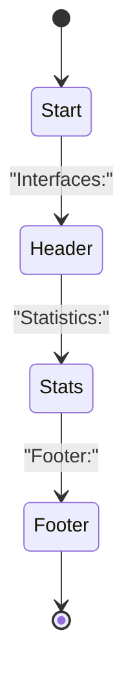
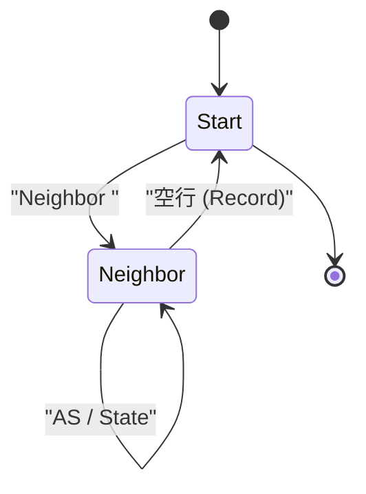
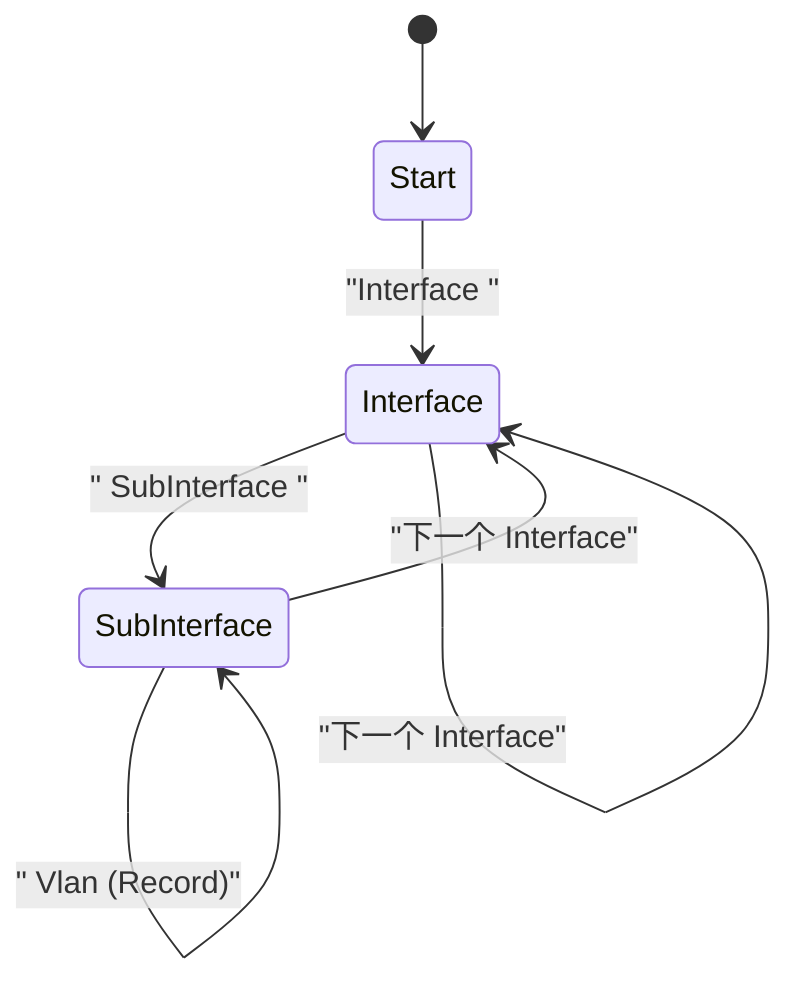
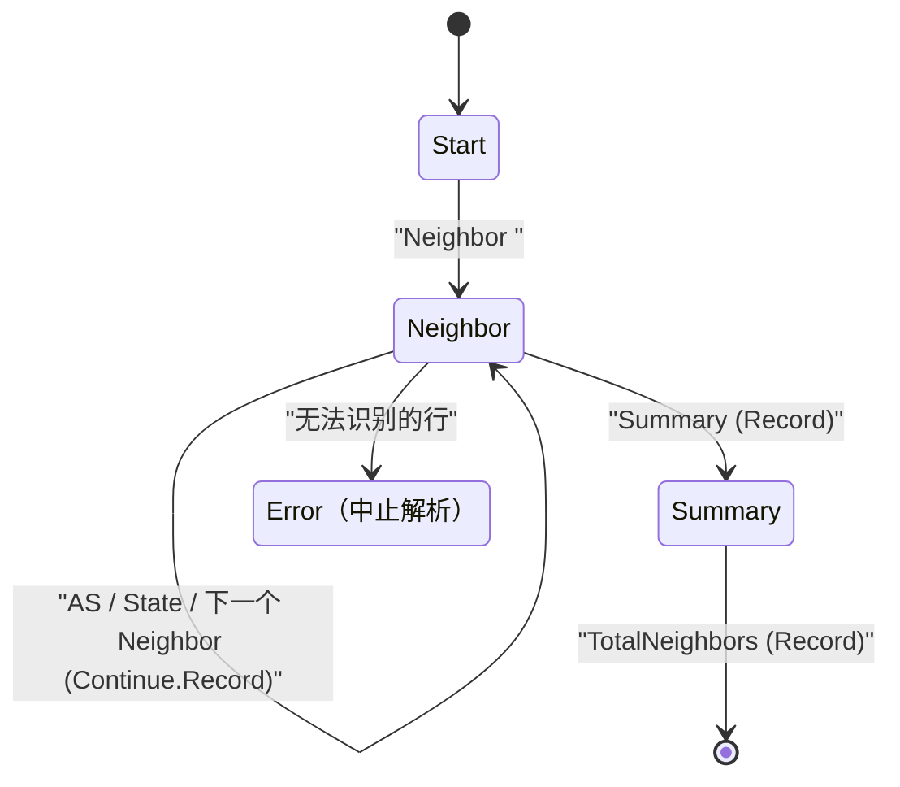
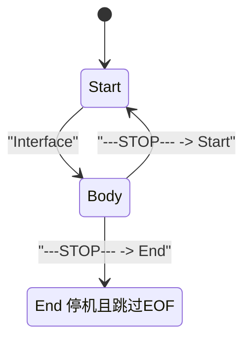
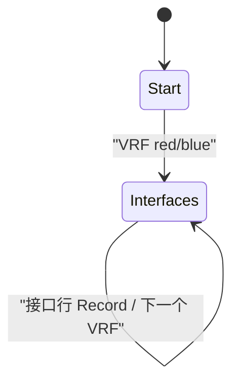
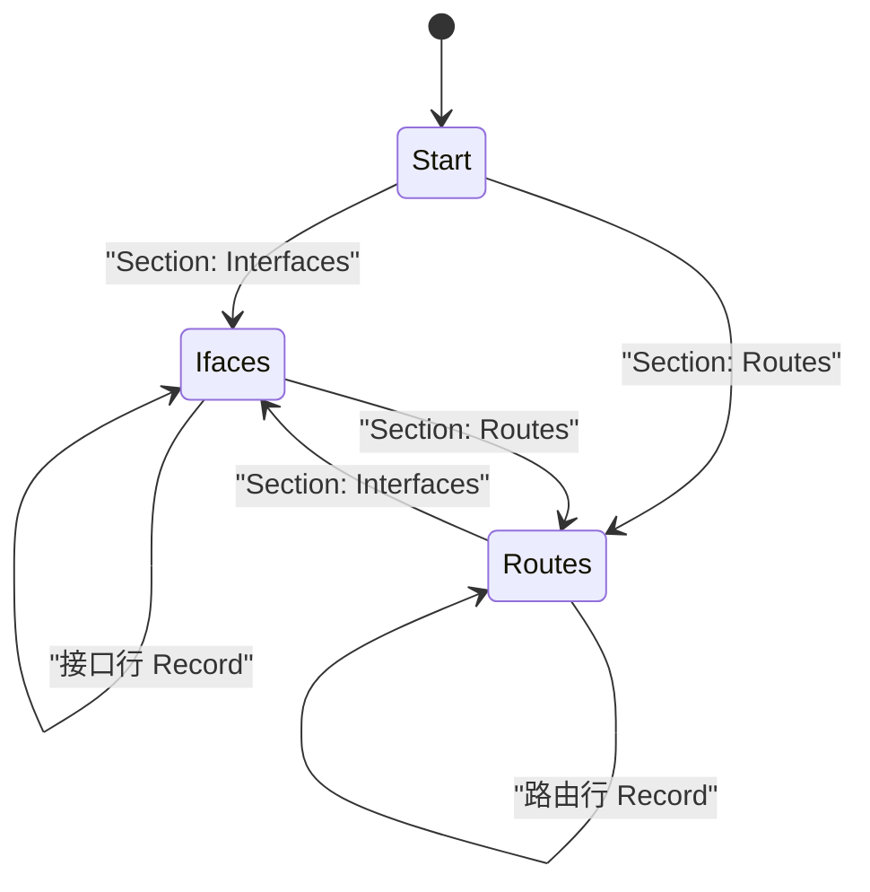

# TextFSM 专题：彻底搞懂"切换 State"

> 本文承接 [textfsm/value_state_rule.md](value_state_rule.md) 中的流程图：
>
> ```
> Rule 逐条匹配
>    │
>    ├──匹配成功
>    │      │
>    │      ├──提取 Value
>    │      ├──执行 Action
>    │      └──切换 State（可选）
>    │
>    └──匹配失败
>           │
>           ▼
>     尝试下一条 Rule
> ```
>
> 上面这一条"切换 State（可选）"，看起来只是一行字，但它其实是 TextFSM 里
> 花样最多、最容易踩坑、也最能体现"状态机"精髓的部分。
>
> 本文专门围绕**切换 State**，分两组共 20 个由浅入深的示例：
> 第一组（1–10）把 Action 三件套讲清，
> 第二组（11–20）把切换时机、Value 生命周期、保留状态讲透。
> 目标是让你看完之后，对着任何一份 TextFSM 模板，
> 都能一眼看出"这一行读完之后，FSM 会跑到哪里去"。

---

## 开始之前：Rule 的完整语法

之前的文档只写了

```
Regex -> Action
```

其实 `Action` 部分是有完整语法的：

```
Regex -> [LineOp[.RecordOp]] [NewState]
```

拆开看：

| 部分 | 取值 | 默认值 | 作用 |
|------|------|--------|------|
| LineOp | `Next` \| `Continue` | `Next`（可省略） | 这一行还要不要继续尝试下面的 Rule |
| RecordOp | `Record` \| `NoRecord` \| `Clear` \| `Clearall` | `NoRecord`（可省略） | 要不要把当前 Value 保存成一条记录（或清空） |
| NewState | 状态名 / `End` / `EOF` / `Error "msg"` | 留在当前状态 | **切换到哪个 State** |

也就是说，**"切换 State"永远是 Action 里最后一个、独立的一段**，
它和"要不要 Record"、"要不要继续匹配这一行"是三件互不冲突的事情，
可以自由组合。

再补充两条对理解"切换 State"至关重要的隐藏规则：

1. **Record 会清空 Value**
   执行 `Record` 之后，所有没有标记为 `Filldown` 的 Value 会被自动清空，
   为下一条记录做准备。这个规则会在示例 6 里造成一个经典的"坑"。
2. **EOF 是一个隐藏的、自动切换进入的 State**
   输入读完之后，如果当前不在 `End` 状态，TextFSM 会自动"切换"进入
   一个隐藏的 `EOF` 状态。如果模板没有显式定义 `EOF`，默认行为是再做
   一次 `Record`。这个会在示例 7 详细展开。

带着这两条规则，我们先看第一组 10 个示例。第二组会再用到
`Clear` / `Clearall` / `Filldown` / `Required` / `List` / `End`，
以及一条加载期硬约束：**`Continue` 禁止带 `NewState`**。

---

# 示例1：最基础的切换 —— 只换状态，什么都不做

## 场景

命令输出先有一行标题，之后才是真正的数据行。
我们要做的，仅仅是"看到标题行，就把 FSM 切到负责解析数据行的 State"。

## 输入

```text
Interface Status
Gi0/0 up
Gi0/1 down
```

## 模板

```text
Value IFACE (\S+)
Value STATUS (\S+)

Start
  ^Interface Status -> Body

Body
  ^${IFACE}\s+${STATUS} -> Record
```

## 说明

`^Interface Status -> Body` 这一行的 Action 只写了一个单词 `Body`。
按照上面的语法拆解，它等价于：

```
LineOp   = Next     （省略，默认）
RecordOp = NoRecord （省略，默认）
NewState = Body
```

翻译成人话：**这一行不产生任何记录，只是单纯地把"当前所在的 Rule 表"
换成 `Body` 状态的 Rule 表**。从下一行开始，`Start` 状态里的规则
（其实这里也只有一条）就彻底失效了。

## 输出

```
[
  {"IFACE": "Gi0/0", "STATUS": "up"},
  {"IFACE": "Gi0/1", "STATUS": "down"}
]
```

---

# 示例2：切换 + Record 同时发生 —— 顺序很关键

## 场景

解析 BGP 邻居详情，遇到 `Summary` 关键字时，
需要把刚刚收集到的这个邻居的信息保存成一条记录，
然后再切换到专门解析汇总信息的 State。

## 输入

```text
Neighbor 1.1.1.1
  AS 65001
  State Established
Summary
  TotalNeighbors 1
```

## 模板

```text
Value IP (\S+)
Value ASN (\d+)
Value STATE (\S+)
Value TOTAL (\d+)

Start
  ^Neighbor ${IP} -> Neighbor

Neighbor
  ^\s+AS ${ASN}
  ^\s+State ${STATE}
  ^Summary -> Record Summary

Summary
  ^\s+TotalNeighbors ${TOTAL} -> Record
```

## 说明

关键的一行是：

```
^Summary -> Record Summary
```

Action 部分是 `Record Summary`，拆解为：

```
LineOp   = Next    （省略）
RecordOp = Record
NewState = Summary
```

**执行顺序永远是：先提取 Value → 再执行 RecordOp → 最后切换 State。**

也就是说，`Record` 发生的那一刻，用的还是"旧状态"里已经收集好的
`IP=1.1.1.1`、`ASN=65001`、`STATE=Established`，
**切换到 `Summary` 只是给"下一行"用的，不会影响这次 Record 的内容。**

很多人第一次看到 `Record NewState` 会以为"是不是应该先切状态、
再用新状态的字段去 Record"——这是一个常见的误解，实际顺序正相反。

## 输出

```
[
  {"IP": "1.1.1.1", "ASN": "65001", "STATE": "Established", "TOTAL": ""},
  {"IP": "", "ASN": "", "STATE": "", "TOTAL": "1"}
]
```

（第二条记录里 IP/ASN/STATE 为空，是因为 `Record` 之后 Value 会被自动
清空——这就是前面提到的"隐藏规则 1"。）

---

# 示例3：空行触发状态回退

## 场景

一个 Neighbor 的详情块用空行结束，遇到空行就说明这个块解析完了，
应该退回到最初的 `Start` 状态，准备迎接下一个块（或者别的 Section）。

## 输入

```text
Neighbor 1.1.1.1
  AS 65001
  State Established

```

## 模板

```text
Value IP (\S+)
Value ASN (\d+)
Value STATE (\S+)

Start
  ^Neighbor ${IP} -> Neighbor

Neighbor
  ^\s+AS ${ASN}
  ^\s+State ${STATE}
  ^$$ -> Record Start
```

## 说明

```
^$$ -> Record Start
空行匹配：^$$（两个$），TextFSM 特殊语法，代表匹配文本中的空行；单^$会报变量替换错误
```

`^$$` 匹配空行；Action 是 `Record Start`：先把当前收集到的一整条
Neighbor 记录保存下来，再把 State 切回 `Start`。

这是所有"分块/分段"解析模板里出现频率最高的一行，
本质上和示例 2 是同一种"Record + 切换"组合，
只是触发条件换成了空行，目标状态换成了"回到起点"。

## 输出

```
[
  {"IP": "1.1.1.1", "ASN": "65001", "STATE": "Established"}
]
```

---

# 示例4：三级状态流水线 —— 线性切换

## 场景

模拟一个分三段输出的命令：先是接口表，再是统计信息，最后是脚注。
三段格式完全不同，天然需要三个 State 依次接力。

## 输入

```text
show interfaces status

Interfaces:
Gi0/0 up
Gi0/1 down

Statistics:
InputPackets 1024
OutputPackets 2048

Footer:
Generated 2026-09-03
```

## 模板

```text
Value IFACE (\S+)
Value STATUS (\S+)
Value INPKT (\d+)
Value OUTPKT (\d+)
Value TS (\S+)

Start
  ^Interfaces: -> Header

Header
  ^${IFACE}\s+${STATUS} -> Record
  ^Statistics: -> Stats

Stats
  ^InputPackets ${INPKT}
  ^OutputPackets ${OUTPKT} -> Record
  ^Footer: -> Footer

Footer
  ^Generated ${TS} -> Record
```

## 状态转移图



## 说明

四个 State（`Start`、`Header`、`Stats`、`Footer`）像接力棒一样，
每个 State 只关心自己那一段格式，**互不干扰**：
一旦切换到 `Stats`，`Header` 里那条接口正则就彻底用不上了。

这是最直观的"State = 我正在解析哪个区域"的体现，
也是绝大多数"多段式 CLI 输出"模板的基本骨架。

## 输出

```
[
  {"IFACE": "Gi0/0", "STATUS": "up"},
  {"IFACE": "Gi0/1", "STATUS": "down"},
  {"INPKT": "1024", "OUTPKT": "2048"},
  {"TS": "2026-09-03"}
]
```

---

# 示例5：状态自循环 —— 解析重复出现的列表块

## 场景

真实世界里最常见的其实不是"线性流水线"，而是"同一种结构反复出现"：
比如一份配置里有好几个 Neighbor，块与块之间用空行分隔。
这本质上是示例1（切换进入）+ 示例3（空行回退）的组合，
只是"回退之后又会再次被切换进入"，形成一个循环。

## 输入

```text
Neighbor 1.1.1.1
  AS 65001
  State Established

Neighbor 2.2.2.2
  AS 65002
  State Idle

```

## 模板

```text
Value IP (\S+)
Value ASN (\d+)
Value STATE (\S+)

Start
  ^Neighbor ${IP} -> Neighbor

Neighbor
  ^\s+AS ${ASN}
  ^\s+State ${STATE}
  ^$$ -> Record Start
```

## 状态转移图



## 说明

注意这张图里 `Neighbor --> Start` 和 `Start --> Neighbor` 之间
形成了一个闭环：**State 图不一定是一条直线，出现"环"是完全正常的，
而且是解析"列表/重复块"最自然的写法。**

这里特意让每个 Neighbor 块后面都跟一个空行，
这样每次"回到 Start"都发生在一次干净的 `Record` 之后，
不会有任何数据从上一块"泄漏"到下一块——这一点在示例6会看到，
一旦没有这个空行做缓冲，事情就没这么简单了。

## 输出

```
[
  {"IP": "1.1.1.1", "ASN": "65001", "STATE": "Established"},
  {"IP": "2.2.2.2", "ASN": "65002", "STATE": "Idle"}
]
```

---

# 示例6：Continue 不是"切换 State"—— 一个经典的坑与修复

## 场景

现实里经常没有那么"贴心"的空行分隔符，Neighbor 块常常是紧挨着的：

```text
Neighbor 1.1.1.1
  AS 65001
  State Established
Neighbor 2.2.2.2
  AS 65002
  State Idle
```

很自然地，你可能会照搬示例2的写法，觉得"看到下一个 Neighbor，
就 Record 当前的，再切到 Neighbor 状态"：

## 错误示范

```text
Value IP (\S+)
Value ASN (\d+)
Value STATE (\S+)

Start
  ^Neighbor ${IP} -> Neighbor

Neighbor
  ^\s+AS ${ASN}
  ^\s+State ${STATE}
  ^Neighbor ${IP} -> Record Neighbor
```

### 为什么错了

问题出在最后一行 `^Neighbor ${IP} -> Record Neighbor` 本身：
它的正则里含有 `${IP}`，**提取 Value 永远发生在 Record 之前**。
于是处理 "Neighbor 2.2.2.2" 这一行时，真实的执行顺序是：

```
1. 正则匹配，把 IP 覆盖成 "2.2.2.2"（新值！）
2. 执行 Record   ← 但此时 IP 已经被新值污染
3. 切换到 Neighbor 状态
```

也就是说，第一条记录里的 IP 会被错误地记成 `2.2.2.2`，
而不是它本该属于的 `1.1.1.1`：

```
错误输出：
[
  {"IP": "2.2.2.2", "ASN": "65001", "STATE": "Established"},
  {"IP": "", "ASN": "65002", "STATE": "Idle"}
]
```

这是 TextFSM 里最经典的坑之一。

## 正确修复：用 Continue 把"识别"和"提取"拆成两条 Rule

```text
Value IP (\S+)
Value ASN (\d+)
Value STATE (\S+)

Start
  ^Neighbor ${IP} -> Neighbor

Neighbor
  ^\s+AS ${ASN}
  ^\s+State ${STATE}
  ^Neighbor \S+ -> Continue.Record
  ^Neighbor ${IP} -> Neighbor
```

## 说明：Continue 是"同一行的维度"，切换 State 是"下一行的维度"

处理 "Neighbor 2.2.2.2" 这一行时：

```
第1条候选 Rule：^Neighbor \S+ -> Continue.Record
  - 这个正则里【没有】 ${IP}，所以不会覆盖 IP 的值
  - 执行 Record：用的是旧值 IP=1.1.1.1, ASN=65001, STATE=Established（正确！）
  - Record 之后，IP/ASN/STATE 被自动清空
  - LineOp = Continue → 不要换行，接着用【同一行】去试下一条 Rule

第2条候选 Rule：^Neighbor ${IP} -> Neighbor
  - 这次才真正提取 IP=2.2.2.2
  - 切换到 Neighbor 状态，准备接收 AS / State
```

这就是本示例最重要的结论：

> **`Continue` 控制的是"这一行还要不要跟下面的 Rule 再比一次"，
> 它和"切换到哪个 State"是完全独立的两个维度。**
> 很多人以为 `Continue` 是某种"状态动作"，其实它只影响
> "同一行"内部的匹配循环，State 该怎么切还是怎么切、
> 该不该切也完全由 `NewState` 那一段决定。

## 输出（修复后）

```
[
  {"IP": "1.1.1.1", "ASN": "65001", "STATE": "Established"},
  {"IP": "2.2.2.2", "ASN": "65002", "STATE": "Idle"}
]
```

（最后一条记录能出现，靠的是示例7要讲的 EOF 隐式收尾——因为这份输入
结尾没有空行，也没有下一个 `Neighbor` 行来触发 Record。）

---

# 示例7：EOF —— 输入结束时自动切入的隐藏 State

## 场景

延续示例6的疑问："最后一个 Neighbor 明明没有触发任何 `Record` 规则，
为什么它还是出现在了输出里？" 答案就是 EOF。

## 输入

```text
Interface Gi0/0
  Status up
```

## 模板（完全没有写任何 Record！）

```text
Value IFACE (\S+)
Value STATUS (\S+)

Start
  ^Interface ${IFACE} -> Body

Body
  ^\s+Status ${STATUS}
```

## 说明：默认的隐式 EOF

这份模板从头到尾都没有出现 `Record` 这个词。
如果 TextFSM 严格"只做你明确写出来的事情"，输出应该是空的 `[]`。

但实际输出是：

```
[
  {"IFACE": "Gi0/0", "STATUS": "up"}
]
```

原因是：**读完所有输入行之后，TextFSM 会自动尝试"切换"进入一个
隐藏的 `EOF` 状态**。如果模板没有显式定义 `EOF`，并且当前状态不是
`End`，默认行为就是再做一次 `Record`，把已经收集但还没写盘的数据
兜底保存下来。

可以把它理解成，模板末尾隐含了这样一段（你看不见，但它真实存在）：

```text
EOF
  ^.* -> Record
```

## 自定义 EOF：关闭或改写默认行为

如果你**不想要**这个自动兜底（比如担心产生半截的脏数据），
只要显式声明一个空的 `EOF` 状态，就会覆盖掉默认行为：

```text
Start
  ^Interface ${IFACE} -> Body

Body
  ^\s+Status ${STATUS}

EOF
```

这样声明之后，`Body` 状态收集到的最后一条数据**不会**再被自动
Record，输出会变回 `[]`。

> 回顾示例4的三段式模板：如果最后一段（`Footer`）在真实场景里
> 有可能完全缺失，显式声明一个空 `EOF` 就能避免因为默认兜底
> 而产生一条字段基本都是空的"幽灵记录"。

## 两种输出对比

| 模板写法 | 最终输出 |
|----------|----------|
| 不写 EOF（使用默认隐式行为） | `[{"IFACE": "Gi0/0", "STATUS": "up"}]` |
| 显式声明空的 `EOF` | `[]` |

---

# 示例8：Error —— 用"中止"代替"静默丢弃"

## 场景

TextFSM 的默认容错策略非常宽松：**当前 State 下如果一行没有匹配
任何 Rule，它会被直接跳过，不会报错，也不会有任何提示。**
这在数据格式被轻微破坏时，会让你在完全不知情的情况下丢数据。

## 输入（第二个邻居的 AS 字段被破坏成了非数字）

```text
Neighbor 1.1.1.1
  AS 65001
  State Established
Neighbor 2.2.2.2
  AS abc
  State Idle
```

## 危险的默认行为

```text
Value IP (\S+)
Value ASN (\d+)
Value STATE (\S+)

Start
  ^Neighbor ${IP} -> Neighbor

Neighbor
  ^\s+AS ${ASN}
  ^\s+State ${STATE}
  ^Neighbor \S+ -> Continue.Record
  ^Neighbor ${IP} -> Neighbor
```

`  AS abc` 这一行，因为 `${ASN}` 对应的正则是 `\d+`，匹配不上，
于是它**被无声无息地跳过**，`ASN` 字段就这样悄悄地留空了，
你在最终输出里很难第一时间意识到这是"数据错误"而不是"本来就没有 AS"。

## 用 Error 主动暴露问题

在 `Neighbor` 状态的规则表**最下面**加一条兜底规则：

```text
Neighbor
  ^\s+AS ${ASN}
  ^\s+State ${STATE}
  ^Neighbor \S+ -> Continue.Record
  ^Neighbor ${IP} -> Neighbor
  ^\s+\S+ -> Error "Neighbor 状态下出现无法识别的行"
```

## 说明

Rule 是按顺序尝试的，`^\s+\S+` 这种"任意缩进的非空内容"写在
最后一条，专门当"漏网之鱼"的兜底：前面几条正经规则都匹配不上时，
才会轮到它。它的 Action 是：

```
NewState = Error "Neighbor 状态下出现无法识别的行"
```

`Error` 不是普通的 State，而是一条指令：**立刻中止整个解析过程，
抛出异常，并带上你写的这条消息。**

再次处理到 `  AS abc` 这一行时：

```
1. 不匹配 ^\s+AS ${ASN}   （\d+ 要求纯数字）
2. 不匹配 ^\s+State ${STATE}
3. 不匹配 ^Neighbor \S+
4. 不匹配 ^Neighbor ${IP}
5. 匹配 ^\s+\S+ -> Error "..."  → 直接中止，抛出异常
```

从"静默丢弃一个字段"变成了"程序员第一时间就能看到的报错"，
这在处理生产环境的真实 CLI 输出时非常重要——
尤其是在需要对 `show running-config` / `show ...` 输出做机读校验的
DOCSIS / vCMTS 场景下，"宁可报错，也不要悄悄给错的数据"往往是更安全的选择。

## 输出

```
TextFSMError: Neighbor 状态下出现无法识别的行
```

---

# 示例9：按缩进切换子状态 —— 用 State 表达"层级"

## 场景

接口下面可能还有子接口，子接口是"嵌套"在接口里面的一层。
State 不仅能表达"前后不同的区域"，也能表达"父子层级关系"。

## 输入

```text
Interface Gi0/0
  Description Uplink-to-Core
  SubInterface Gi0/0.10
    Vlan 10
Interface Gi0/1
  Description Access-Port
```

## 模板

```text
Value IFACE (\S+)
Value DESC (.+)
Value SUBIF (\S+)
Value VLAN (\d+)

Start
  ^Interface ${IFACE} -> Interface

Interface
  ^\s{2}Description ${DESC}
  ^\s{2}SubInterface ${SUBIF} -> SubInterface
  ^Interface ${IFACE} -> Interface

SubInterface
  ^\s{4}Vlan ${VLAN} -> Record
  ^Interface ${IFACE} -> Interface
```

## 状态转移图



## 说明

两级缩进（2 个空格、4 个空格）对应两级 State：

- `Interface`：负责这一层的字段（`Description`），
  以及"要不要往下钻一层"（遇到 `SubInterface` 就切到 `SubInterface`）。
- `SubInterface`：负责更深一层的字段（`Vlan`），
  并且要能识别"父层级的新记录开始了"（遇到顶格的 `Interface`），
  从而**跳出**当前的子层级，回到 `Interface`。

注意 `SubInterface` 状态里那条 `^Interface ${IFACE} -> Interface`：
它不是"跳回 Start"，而是直接跳到"兄弟层级"的 `Interface` 状态——
State 之间的切换完全由你决定去哪，并不要求一定要"原路返回"。

## 逐行执行过程

```
Interface Gi0/0            Start → Interface   (IFACE=Gi0/0)
  Description Uplink...    Interface 状态内收集 DESC
  SubInterface Gi0/0.10    Interface → SubInterface (SUBIF=Gi0/0.10)
    Vlan 10                Record！ (Gi0/0 / Gi0/0.10 / Vlan10)
Interface Gi0/1            SubInterface → Interface (IFACE=Gi0/1)
  Description Access-Port  Interface 状态内收集 DESC
```

## 输出

```
[
  {"IFACE": "Gi0/0", "DESC": "Uplink-to-Core", "SUBIF": "Gi0/0.10", "VLAN": "10"}
]
```

> 注意：`Interface Gi0/1` 这个块因为没有 `SubInterface`/`Vlan`，
> 永远不会触发 `Record`，所以默认情况下它**不会**出现在输出里——
> 除非像示例7那样依赖隐式 EOF；但由于解析停在了 `Interface` 状态，
> 而且我们没有为它设计收尾规则，这个块的信息本来就会被丢弃。
> 这也说明：**State 切换到哪、什么时候 Record，必须配套设计，
> 否则某些分支会"进得去、出不来、也存不下"。**

---

# 示例10：综合实战 —— 把所有技巧拼成一台完整的状态机

## 场景

把前面 9 个示例的技巧拼在一起，解析一份更接近真实世界的
"BGP 邻居 + 汇总 + 异常行"输出：

- 多个 Neighbor 块，中间没有空行分隔（示例6：`Continue.Record`）
- 末尾有一个 `Summary` 区块（示例2：Record + 切换到新 State）
- 遇到格式错误的行要主动报错（示例8：`Error`）
- 显式关闭默认的 EOF 兜底，避免半截数据（示例7：自定义 `EOF`）

## 输入

```text
Neighbor 1.1.1.1
  AS 65001
  State Established
Neighbor 2.2.2.2
  AS 65002
  State Idle
Summary
  TotalNeighbors 2
```

## 模板

```text
Value IP (\S+)
Value ASN (\d+)
Value STATE (\S+)
Value TOTAL (\d+)

Start
  ^Neighbor ${IP} -> Neighbor

Neighbor
  ^\s+AS ${ASN}
  ^\s+State ${STATE}
  ^Neighbor \S+ -> Continue.Record
  ^Neighbor ${IP} -> Neighbor
  ^Summary -> Record Summary
  ^\s+\S+ -> Error "Neighbor 状态下出现无法识别的行"

Summary
  ^\s+TotalNeighbors ${TOTAL} -> Record

EOF
```

## 完整状态转移图



## 逐行说明

```
Neighbor 1.1.1.1     Start → Neighbor              (IP=1.1.1.1)
  AS 65001           Neighbor 状态内收集 ASN
  State Established  Neighbor 状态内收集 STATE
Neighbor 2.2.2.2      命中 "Continue.Record" → Record(1.1.1.1记录)，清空
                       接着同一行再命中 "-> Neighbor" → IP=2.2.2.2
  AS 65002           收集 ASN
  State Idle         收集 STATE
Summary              命中 "Record Summary" → Record(2.2.2.2记录)，切到 Summary
  TotalNeighbors 2   Summary 状态内 -> Record
```

因为最后显式声明了空的 `EOF` 状态，输入结束时**不会**再产生任何
多余的兜底记录——三条记录该有的都有了，不多不少。

如果这份输入里混入一行格式错误的数据（比如 `AS xyz`），
在到达 `Neighbor` 状态末尾的兜底规则时会直接 `Error` 中止，
而不是像"裸奔"的模板那样悄悄丢掉这个字段。

## 输出

```
[
  {"IP": "1.1.1.1", "ASN": "65001", "STATE": "Established", "TOTAL": ""},
  {"IP": "2.2.2.2", "ASN": "65002", "STATE": "Idle", "TOTAL": ""},
  {"IP": "", "ASN": "", "STATE": "", "TOTAL": "2"}
]
```

---

# 第二组：切换时机、Value 生命周期、保留状态

第一组已经证明：`LineOp`、`RecordOp`、`NewState` 是三个独立旋钮。
第二组要回答的是另外三个更隐蔽的问题：

- **什么时候切？** `Continue` 能不能一边留在本行、一边换规则表？
- **切的时候 Value 怎么活、怎么死？** `Clear` / `Clearall` / `Filldown` / `List` / `Required`
- **切到保留状态意味着什么？** `End` 和 `EOF` 不是普通业务 State

以下 10 个示例全部用本机 `textfsm 2.1.0` 跑过，输出是实测结果，不是按 Wiki 臆造的。

---

# 示例11：Continue 禁止带 NewState —— 加载期就失败

## 场景

示例 6 把"识别下一个 Neighbor"和"提取新 IP"拆成了两条 Rule：

```text
^Neighbor \S+ -> Continue.Record
^Neighbor ${IP} -> Neighbor
```

有人会觉得这太啰嗦，想合成一句：`Continue.Record` 的同时还切回 `Neighbor`。
这正好撞上官方的一条硬约束。

## 错误示范（模板无法加载）

```text
Value IP (\S+)
Value ASN (\d+)
Value STATE (\S+)

Start
  ^Neighbor ${IP} -> Neighbor

Neighbor
  ^\s+AS ${ASN}
  ^\s+State ${STATE}
  ^Neighbor \S+ -> Continue.Record Neighbor
```

## 实测报错

```
TextFSMTemplateError: Action 'Continue' with new state Neighbor specified. Line: 11.
```

注意：这是**加载模板**时就抛的，输入文本还没开始读。
它不是运行期的"切错了"，而是语法层直接拒绝。

## 为什么官方要禁

`Continue` 的含义是：

> 这一行还没结束，继续用**当前 State 的规则表**往下比。

`NewState` 的含义是：

> 换一套规则表。

两者互相打架。如果允许 `Continue Neighbor`，下一秒既要"留在本行接着比当前表"，
又要"改用 Neighbor 的表"——状态机立刻可能打环。
官方原文写得很干脆：

> The Continue action does not accept a state transition. This ensures that state machines are loop free.

所以正确拆法仍然是示例 6 那两行：

```text
^Neighbor \S+ -> Continue.Record
^Neighbor ${IP} -> Neighbor
```

第一条只负责"本行先 Record 旧值，然后继续比"；
第二条才负责"提取新 IP，并（如有需要）切到 Neighbor"。
**同一行里的 Continue，和下一行才生效的 NewState，必须拆开写。**

## 输出（正确拆法，输入同示例 6）

```
[
  {"IP": "1.1.1.1", "ASN": "65001", "STATE": "Established"},
  {"IP": "2.2.2.2", "ASN": "65002", "STATE": "Idle"}
]
```

---

# 示例12：End —— 关机，而且跳过 EOF

## 场景

输入里有一个明确的"后面都不要了"标记。我们希望读到它就停机，
既不解析后面的块，也不再走隐式 EOF 的兜底 Record。

## 输入

```text
Interface Gi0/0
  Status up
---STOP---
Interface Gi0/1
  Status down
```

## 模板 A：Status 行先 Record，再在 STOP 处切到 End

```text
Value IFACE (\S+)
Value STATUS (\S+)

Start
  ^Interface ${IFACE} -> Body

Body
  ^\s+Status ${STATUS} -> Record
  ^---STOP--- -> End
  ^Interface ${IFACE} -> Body
```

## 输出 A

```
[
  {"IFACE": "Gi0/0", "STATUS": "up"}
]
```

`Gi0/1` 整段消失：切到 `End` 之后，后续行根本不会再读。

## 模板 B：Status 只收集、不 Record，然后 End

```text
Value IFACE (\S+)
Value STATUS (\S+)

Start
  ^Interface ${IFACE} -> Body

Body
  ^\s+Status ${STATUS}
  ^---STOP--- -> End
  ^Interface ${IFACE} -> Body
```

## 输出 B

```
[]
```

手头明明已经攒了 `IFACE=Gi0/0`、`STATUS=up`，但 `End` **不会**再执行隐式 EOF。
半截数据直接扔掉。这就是 `End` 和"读到文件尾"的本质差别。

## 对照：把 `-> End` 改成 `-> Start`

```text
  ^---STOP--- -> Start
```

## 输出（改成 Start 之后）

```
[
  {"IFACE": "Gi0/0", "STATUS": "up"},
  {"IFACE": "Gi0/1", "STATUS": "down"}
]
```

`Start` 是普通业务状态，后面的块会继续被解析；
`End` 是保留状态，含义是**关机**，不是"换一套规则接着读"。



---

# 示例13：Clear + 切换 —— 撕草稿纸，不交卷

## 场景

正式表头出现之前，先有一行警告。警告文本被写进了 `WARN`。
如果我们只写 `-> Body`，这条脏值会跟进第一条业务记录；
`-> Clear Body` 则是"先清空非 Filldown，再换规则表"，不产出任何行。

## 输入

```text
WARNING: maintenance window
Interface Status
Gi0/0 up
Gi0/1 down
```

## 错误：只切换、不 Clear

```text
Value WARN (.+)
Value IFACE (\S+)
Value STATUS (\S+)

Start
  ^WARNING: ${WARN}
  ^Interface Status -> Body

Body
  ^${IFACE}\s+${STATUS} -> Record
```

## 实测输出（脏值泄漏）

```
[
  {"WARN": "maintenance window", "IFACE": "Gi0/0", "STATUS": "up"},
  {"WARN": "", "IFACE": "Gi0/1", "STATUS": "down"}
]
```

第一条记录被警告污染。第二条是干净的，因为第一次 `Record` 已经把非 Filldown 的 `WARN` 清掉了。

## 正确：Clear 再切换

```text
Value WARN (.+)
Value IFACE (\S+)
Value STATUS (\S+)

Start
  ^WARNING: ${WARN}
  ^Interface Status -> Clear Body

Body
  ^${IFACE}\s+${STATUS} -> Record
```

## 实测输出

```
[
  {"WARN": "", "IFACE": "Gi0/0", "STATUS": "up"},
  {"WARN": "", "IFACE": "Gi0/1", "STATUS": "down"}
]
```

对照三个 RecordOp 在"切换"时的角色：

- `Record`：先交卷，再清空非 Filldown，然后切
- `Clear`：不交卷，只清空非 Filldown，然后切
- `NoRecord`（默认）：草稿纸原封不动地带进下一个 State

---

# 示例14：Filldown 跨 State 当父上下文

## 场景

真实 CLI 里最常见的不是"切了就忘掉一切"，而是"父区块的名字要印在每一条子记录上"。
VRF 名在 `Start` 里提取，切到 `Interfaces` 之后，每次 `Record` 都应该带着它。

## 输入

```text
VRF red
  Gi0/0 10.1.1.1
  Gi0/1 10.1.1.2
VRF blue
  Gi0/2 10.2.2.1
```

## 模板

```text
Value Filldown VRF (\S+)
Value IFACE (\S+)
Value IP (\S+)

Start
  ^VRF ${VRF} -> Interfaces

Interfaces
  ^\s+${IFACE}\s+${IP} -> Record
  ^VRF ${VRF} -> Interfaces
```

## 状态转移图



## 逐行执行

```
VRF red          Start 提取 VRF=red，切到 Interfaces
  Gi0/0 10.1.1.1 Record {red, Gi0/0, 10.1.1.1}，IFACE/IP 清空，VRF 留下
  Gi0/1 10.1.1.2 Record {red, Gi0/1, 10.1.1.2}，VRF 仍是 red
VRF blue         覆盖 VRF=blue，仍留在 Interfaces
  Gi0/2 10.2.2.1 Record {blue, Gi0/2, 10.2.2.1}
<EOF>            隐式 Record：VRF=blue 还在，IFACE/IP 已空
```

**切换 State 不会自动丢掉 Value。** `Filldown` 的父键会活过 `Record`，也会活过 State 切换，
直到被下一次匹配覆盖，或被 `Clearall` 杀死。

## 实测输出（默认隐式 EOF）

```
[
  {"VRF": "red",  "IFACE": "Gi0/0", "IP": "10.1.1.1"},
  {"VRF": "red",  "IFACE": "Gi0/1", "IP": "10.1.1.2"},
  {"VRF": "blue", "IFACE": "Gi0/2", "IP": "10.2.2.1"},
  {"VRF": "blue", "IFACE": "",      "IP": ""}
]
```

第四行就是示例 7 说过的 EOF 兜底：`Filldown` 让这条"幽灵记录"看起来像还有数据，
`_AppendRecord` 因此不会因为它"几乎为空"而跳过。
模板末尾加一个空的 `EOF`，幽灵行就消失了，只剩前三行。

---

# 示例15：Clearall 切断 Filldown（和示例 6 同构的时序坑）

## 场景

同一份 VRF 输入。这次我们要对比：切到新 VRF 时，
`Clear` 会留下 Filldown 父键，`Clearall` 会把它一起杀掉。

## 输入（同示例 14）

```text
VRF red
  Gi0/0 10.1.1.1
  Gi0/1 10.1.1.2
VRF blue
  Gi0/2 10.2.2.1
```

## 写法 A：`Clear` —— Filldown 留下

```text
Value Filldown VRF (\S+)
Value IFACE (\S+)
Value IP (\S+)

Start
  ^VRF ${VRF} -> Interfaces

Interfaces
  ^\s+${IFACE}\s+${IP} -> Record
  ^VRF ${VRF} -> Clear Interfaces
```

处理 `VRF blue` 时：先提取 `VRF=blue`，再 `Clear`（只清 IFACE/IP，VRF 是 Filldown，留下），
再切回 `Interfaces`。父上下文是对的。

## 写法 B：错误的 `Clearall` —— 先提取、再自杀

```text
  ^VRF ${VRF} -> Clearall Interfaces
```

执行顺序永远是：**先提取 Value，再做 RecordOp，最后切 State。**
于是 `VRF=blue` 刚写进去，立刻被 `Clearall` 抹掉。
后面的 `Gi0/2` 只能 Record 出一行没有 VRF 的记录。

## 写法 C：正确拆开 `Clearall`

```text
Interfaces
  ^\s+${IFACE}\s+${IP} -> Record
  ^VRF \S+ -> Continue.Clearall
  ^VRF ${VRF} -> Interfaces
```

和示例 6 / 示例 11 同一套路：第一条正则**不捕获** VRF，只负责清空；
`Continue` 留在本行；第二条再提取新的 VRF。

## 三种写法的实测输出

写法 A（`Clear`）：

```
[
  {"VRF": "red",  "IFACE": "Gi0/0", "IP": "10.1.1.1"},
  {"VRF": "red",  "IFACE": "Gi0/1", "IP": "10.1.1.2"},
  {"VRF": "blue", "IFACE": "Gi0/2", "IP": "10.2.2.1"},
  {"VRF": "blue", "IFACE": "",      "IP": ""}
]
```

写法 B（`-> Clearall Interfaces`，提取后自杀）：

```
[
  {"VRF": "red", "IFACE": "Gi0/0", "IP": "10.1.1.1"},
  {"VRF": "red", "IFACE": "Gi0/1", "IP": "10.1.1.2"},
  {"VRF": "",    "IFACE": "Gi0/2", "IP": "10.2.2.1"}
]
```

没有第四行幽灵：`Clearall` 之后 VRF 也是空的，EOF 看到整行都空，会跳过。

写法 C（`Continue.Clearall` 再提取）：

```
[
  {"VRF": "red",  "IFACE": "Gi0/0", "IP": "10.1.1.1"},
  {"VRF": "red",  "IFACE": "Gi0/1", "IP": "10.1.1.2"},
  {"VRF": "blue", "IFACE": "Gi0/2", "IP": "10.2.2.1"},
  {"VRF": "blue", "IFACE": "",      "IP": ""}
]
```

和写法 A 一样正确（同样可以用空 `EOF` 去掉幽灵行）。

> 记住：`Clear` 保 Filldown，`Clearall` 连 Filldown 一起杀。
> `Clearall` 写在"刚刚提取了父键"的那条 Rule 上，等于自杀——
> 这和示例 6 的"Record 前被新值污染"是同一类时序问题。

---

# 示例16：Required 让「切换时的 Record」静默失败

## 场景

`-> Record NewState` 并不保证真的写出一行。
只要有一个 `Required` Value 仍为空，这次 Record **整行丢弃**，但 State 照常切走。
这比示例 8 的 `Error` 更隐蔽：解析成功、没有异常，数据却少了一条。

## 输入

```text
Neighbor 1.1.1.1
  State Established
Neighbor 2.2.2.2
  AS 65002
  State Idle
```

第一个邻居缺 `AS`。

## 模板（ASN 标了 Required）

```text
Value IP (\S+)
Value Required ASN (\d+)
Value STATE (\S+)

Start
  ^Neighbor ${IP} -> Neighbor

Neighbor
  ^\s+AS ${ASN}
  ^\s+State ${STATE}
  ^Neighbor \S+ -> Continue.Record
  ^Neighbor ${IP} -> Neighbor
```

## 逐行

```
Neighbor 1.1.1.1     IP=1.1.1.1，切到 Neighbor
  State Established  STATE=Established（没有 AS 行，ASN 仍空）
Neighbor 2.2.2.2     Continue.Record → ASN 是 Required 且为空 → 整行丢弃
                     同一行再提取 IP=2.2.2.2
  AS 65002           ASN=65002
  State Idle         STATE=Idle
<EOF>                隐式 Record → 第二条成功写出
```

## 实测输出

```
[
  {"IP": "2.2.2.2", "ASN": "65002", "STATE": "Idle"}
]
```

如果把 `Required` 去掉，第一条会带着空 ASN 出现：

```
[
  {"IP": "1.1.1.1", "ASN": "",       "STATE": "Established"},
  {"IP": "2.2.2.2", "ASN": "65002",  "STATE": "Idle"}
]
```

官方 wiki 的 Routing Engine 示例就是靠 `Required Slot` 吃掉"还没读到 Slot 之前的那次 Record"。
它是特性，不是 bug——但你必须知道：**切换照常发生，交卷却可能被拒。**

---

# 示例17：List 在一个 State 里攒，切换时一次性 Record

## 场景

一个接口下面有多行 `ip ...`。`List` 在当前 State 里每次命中都是追加；
真正变成"一行里的数组"，发生在下一次 Record——常常就是"看到下一个块头"。

## 输入

```text
Interface Gi0/0
  ip 10.1.1.1
  ip 10.1.1.2
Interface Gi0/1
  ip 10.2.2.1
```

## 模板

```text
Value IFACE (\S+)
Value List IPS (\S+)

Start
  ^Interface ${IFACE} -> Iface

Iface
  ^\s+ip ${IPS}
  ^Interface \S+ -> Continue.Record
  ^Interface ${IFACE} -> Iface
```

## 逐行

```
Interface Gi0/0     IFACE=Gi0/0，切到 Iface
  ip 10.1.1.1       IPS=["10.1.1.1"]
  ip 10.1.1.2       IPS=["10.1.1.1", "10.1.1.2"]
Interface Gi0/1     Continue.Record → 交出 Gi0/0 那一行（带着整个列表）
                    List 不是 Filldown，Record 之后 IPS 被清空
                    同一行再提取 IFACE=Gi0/1
  ip 10.2.2.1       IPS=["10.2.2.1"]
<EOF>               隐式 Record → 交出 Gi0/1
```

## 实测输出

```
[
  {"IFACE": "Gi0/0", "IPS": ["10.1.1.1", "10.1.1.2"]},
  {"IFACE": "Gi0/1", "IPS": ["10.2.2.1"]}
]
```

`List` 的追加发生在**同一个 State 的多次匹配**里；
`Record`（往往由"下一块的标题行"触发）才是列表的落盘点。
落盘之后列表被清空，不会泄漏到下一块——不必为了"切断列表"去 `Clearall`。

---

# 示例18：EOF 在 2.1.0 里只能是空的，不能写规则

## 场景

示例 7 说过：不写 `EOF` 时，输入结束会隐式再 Record 一次；
写一个空的 `EOF` 就能关掉它。Wiki 上还画过这样一段"隐式 EOF"：

```text
EOF
  ^.* -> Record
```

很多人据此以为：可以在 `EOF` 里写自己的规则，把隐藏行为变成显式规则表。
**在 textfsm 2.1.0 里，这是错的。** 必须用本机库跑过才知道。

## 输入（最后一块没有收尾分隔符）

```text
Interface Gi0/0
  Status up
```

## 三种模板，同一份输入

不写 EOF（默认隐式兜底）：

```text
Value IFACE (\S+)
Value STATUS (\S+)

Start
  ^Interface ${IFACE} -> Body

Body
  ^\s+Status ${STATUS}
```

空的 `EOF`（关闭兜底）：

```text
Start
  ^Interface ${IFACE} -> Body

Body
  ^\s+Status ${STATUS}

EOF
```

试图在 `EOF` 里写规则（Wiki 那种）：

```text
EOF
  ^.* -> Record
```

## 实测

| 写法 | 结果 |
|------|------|
| 不写 EOF | `[{"IFACE": "Gi0/0", "STATUS": "up"}]` |
| 空 `EOF` | `[]` |
| `EOF` 里写 `^.* -> Record` | **加载失败** `TextFSMTemplateError: Non-Empty 'EOF' state.` |
| `End` 里写规则 | 同样加载失败 `Non-Empty 'End' state.` |

源码里的真实实现是：读完所有行之后，若当前不在 `End`、模板里也没有名为 `EOF` 的状态，
就直接调用 `_AppendRecord()`。它**不会**再喂给规则表一行输入，
所以也不存在"EOF 状态匹配 `^.*`"这件事。

空的 `EOF` 只是一个开关：声明了它，`_AppendRecord()` 就不会跑。
`End` / `EOF` 作为**状态体**必须为空；它们能做的只有"在或不在"。

## 补充：`-> EOF` 当跳转目标

`EOF` 和 `End` 仍然是合法的 `NewState`。差别在收尾：

```text
  ^---STOP--- -> EOF
```

- 模板**没有**声明 `EOF`：后面的行不读了，但隐式 `_AppendRecord()` 仍会执行
  （因为 `'EOF' not in self.states`）
- 模板声明了空的 `EOF`：后面的行不读了，隐式 Record 也被关掉
- `-> End`：后面的行不读了，而且**无论你有没有声明 `EOF`**，隐式 Record 都不会跑

所以：`End` 是"关机"；未声明的 `-> EOF` 是"停读但还交一次卷"；
声明了空 `EOF` 再 `-> EOF`，才是"停读且不交卷"。

---

# 示例19：分叉 —— 同一 State 按内容跳到不同下一跳

## 场景

State 图不必是直线，也不必每次回到 `Start`。
`Start` 按标题切到 `Ifaces` 或 `Routes`；这两个业务 State 也可以互相直跳。
没有隐式栈，没有"原路返回"。

## 输入

```text
Section: Interfaces
Gi0/0 up
Section: Routes
10.1.1.0/24 via 1.1.1.1
Section: Interfaces
Gi0/1 down
Section: Routes
10.2.2.0/24 via 2.2.2.2
```

## 模板（标题规则必须写在宽数据规则前面）

```text
Value IFACE (\S+)
Value STATUS (\S+)
Value PREFIX (\S+)
Value NEXTHOP (\S+)

Start
  ^Section: Interfaces -> Ifaces
  ^Section: Routes -> Routes

Ifaces
  ^Section: Routes -> Routes
  ^Section: Interfaces -> Ifaces
  ^${IFACE}\s+${STATUS} -> Record

Routes
  ^Section: Interfaces -> Ifaces
  ^Section: Routes -> Routes
  ^${PREFIX}\s+via\s+${NEXTHOP} -> Record
```

## 状态转移图



## 说明

`Ifaces` 和 `Routes` 互相直跳，**不必回到 Start**。
去哪完全由当前 State 里哪条 Rule 先命中决定。

这里有一个和"切换"同等重要的顺序问题：
如果把 `^${IFACE}\s+${STATUS}` 写在 `^Section: Routes` **前面**，
`Section: Routes` 会被当成 `IFACE=Section:`、`STATUS=Routes` 记下一行假数据，
FSM 永远走不出 `Ifaces`。实测就是这样。

**分叉能成立，前提是"决定去哪"的标题规则，排在"吃数据"的宽正则前面。**

## 实测输出

```
[
  {"IFACE": "Gi0/0", "STATUS": "up",   "PREFIX": "",           "NEXTHOP": ""},
  {"IFACE": "",      "STATUS": "",    "PREFIX": "10.1.1.0/24", "NEXTHOP": "1.1.1.1"},
  {"IFACE": "Gi0/1", "STATUS": "down", "PREFIX": "",           "NEXTHOP": ""},
  {"IFACE": "",      "STATUS": "",    "PREFIX": "10.2.2.0/24", "NEXTHOP": "2.2.2.2"}
]
```

---

# 示例20：未匹配行 = 隐式停留（不是切换）

## 场景

「不切换」本身也是一种状态决策。
当前 State 对某一行全部 Rule 都失败时，FSM **留在原地**，丢掉这一行，
继续用同一套 Rule 看下一行。它不会自动退回 `Start`。

## 对照 A：块中间夹一行注释

输入

```text
Neighbor 1.1.1.1
  ! this is a comment
  AS 65001
  State Established
```

模板

```text
Value IP (\S+)
Value ASN (\d+)
Value STATE (\S+)

Start
  ^Neighbor ${IP} -> Neighbor

Neighbor
  ^\s+AS ${ASN}
  ^\s+State ${STATE}
```

`  ! this is a comment` 在 `Neighbor` 里没有任何 Rule 能吃掉它，
于是被跳过。FSM 仍留在 `Neighbor`，后面的 AS / State 照常收集。
隐式 EOF 交出完整的一条：

```
[
  {"IP": "1.1.1.1", "ASN": "65001", "STATE": "Established"}
]
```

## 对照 B：把你切进来的表头，再次出现在 Body 里

输入

```text
Interface Status
Gi0/0 up
Interface Status
Gi0/1 down
```

模板（注意 `IFACE` 收窄成 `Gi\S+`，避免表头自己被当成数据）

```text
Value IFACE (Gi\S+)
Value STATUS (\S+)

Start
  ^Interface Status -> Body

Body
  ^${IFACE}\s+${STATUS} -> Record
```

第二行 `Interface Status` 出现时，当前已经在 `Body`。
`Body` 没有针对表头的 Rule，`Gi\S+` 也吃不掉 `Interface`，
于是这一行被跳过，FSM **仍留在 Body**。下一行 `Gi0/1 down` 继续按 Body 的规则解析。

```
[
  {"IFACE": "Gi0/0", "STATUS": "up"},
  {"IFACE": "Gi0/1", "STATUS": "down"}
]
```

如果把 `IFACE` 写成宽松的 `(\S+)`，第二行表头反而会命中 `^${IFACE}\s+${STATUS}`，
产出一条假记录 `{"IFACE": "Interface", "STATUS": "Status"}`。
"未匹配才停留"的前提是：宽正则没有误把噪声当成数据。

## 回扣示例 8

默认策略是宽松的：不认识的行 = 丢掉、原地不动。
想把"静默跳过"变成"立刻失败"，就在该 State 规则表最下面加兜底：

```text
  ^.+ -> Error "当前状态下出现无法识别的行"
```

未匹配、Error、End，是三种完全不同的"停"：

- **未匹配**：丢这一行，人还在这个房间
- **Error**：烧掉整张答卷，抛异常
- **End**：合上卷子走人，后面的页不看了，EOF 也不再补记

---

# 语法速查：所有"切换 State"的写法

| 写法 | 含义 | 对应示例 |
|------|------|----------|
| `-> NewState` | 只切换 State，不 Record，不影响本行匹配 | 示例1 |
| `-> Record NewState` | 先用**当前**（旧）Value 做一次 Record，再切换 State | 示例2 |
| `^$$ -> Record Start` | 空行触发"回退型"切换，是分段/分块解析的标配 | 示例3、5 |
| （无 NewState） | 停留在当前 State（默认行为，省略即可） | 示例4 |
| 自环：`A -> B` 又 `B -> A/B` | State 图出现"环"，用来解析重复出现的列表块 | 示例5 |
| `Continue.Record` + 紧跟一条捕获新值的 Rule | 把"识别新块"和"提取新值"拆成两条 Rule，避免 Record 前被新值污染 | 示例6 |
| 隐式 `EOF` | 输入结束时自动"切入"的隐藏 State，默认做一次 Record | 示例7 |
| 显式空 `EOF` | 关闭默认的收尾 Record，避免半截脏数据 | 示例7、10 |
| `-> Error "msg"` | 一种"终止型"切换：不去下一个 State，而是直接中止解析并报错 | 示例8 |
| 不同层级的 State 互相跳转（不一定原路返回） | 用 State 表达父子/嵌套层级关系 | 示例9 |
| `Continue` + `NewState` 写在同一条 Rule | **非法**：加载期 `TextFSMTemplateError`，必须拆成两条 | 示例11 |
| `-> End` | 保留状态：立刻停读，且跳过隐式 EOF | 示例12 |
| `-> Clear NewState` | 不交卷，只清非 Filldown，再换规则表 | 示例13 |
| `Value Filldown` 跨 State | 切换不会丢掉父键，每次 Record 都带着它 | 示例14 |
| `Clear` vs `Clearall` + 切换 | `Clear` 保 Filldown；`Clearall` 连父键一起杀，提取后再 Clearall 等于自杀 | 示例15 |
| `Value Required` + `Record` | 切换照常发生，Required 为空则整行丢弃 | 示例16 |
| `Value List` + 下一块标题处 `Continue.Record` | 列表在同一 State 里追加，Record 时一次性落盘并清空 | 示例17 |
| 空 `EOF` / 非空 `EOF` / `-> EOF` | 2.1.0 里 EOF/End 状态体必须为空；未声明的 `-> EOF` 停读但仍隐式 Record | 示例18 |
| 同一 State 按标题分叉到不同下一跳 | 没有隐式栈；标题规则必须写在宽数据正则前面 | 示例19 |
| 当前 State 全部 Rule 失败 | **隐式停留**：丢这一行，不退回 Start | 示例20 |

## 一句话记住"切换 State"这三个字的本质

> **切换 State，本质上是在告诉 FSM："从下一行开始，请换一套 Rule 来看待输入。"**
> 它只决定"接下来用谁的规则表"，
> 至于"这一行要不要留痕迹（Record）"、
> "这一行要不要再比一次别的 Rule（Continue）"，
> 都是可以自由搭配的独立选项——
> 三者组合起来，才拼出了 TextFSM 状态机的全部表达力。

## 记忆口诀

- **不切换**：这一行读完，原地不动，继续用老规矩。
- **切换但不 Record**：换个地方接着读，但这一行本身不算一条完整数据。
- **切换且 Record**：先把手头攒的数据交上去，再挪窝到新的地方。
- **自环切换**：挪来挪去其实是在原地打转，专门用来吃掉"重复出现的块"。
- **切到 Error**：不挪了，直接停机，把问题喊出来。
- **切到 End**：合上卷子走人，后面的页不看了，EOF 也不再补记。
- **切到隐藏的 EOF**：不是你写的，是 TextFSM 在收尾时自己走的一步，
  别忘了它，也别忘了可以用空 `EOF` 把它关掉；
  别以为能在 `EOF` 里写规则——2.1.0 会直接拒绝非空的 `EOF` / `End`。
- **Continue 不能带着 NewState**：本行继续比、和换规则表，必须拆成两条 Rule。
- **Clear 是撕草稿纸，Clearall 连 Filldown 父键一起撕**；
  提取之后立刻 Clearall / Record，都会踩到"先写新值再被操作符改掉"的时序坑。
- **Required 让 Record 可能交白卷**：State 照切，行却丢了。
- **未匹配不是离开**：丢这一行，人还在这个房间。
