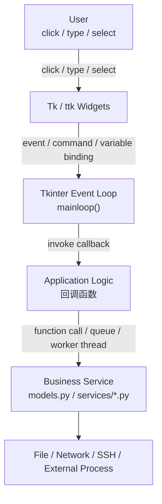
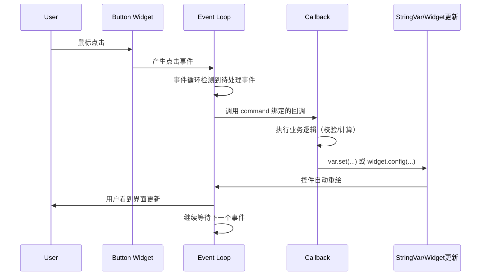
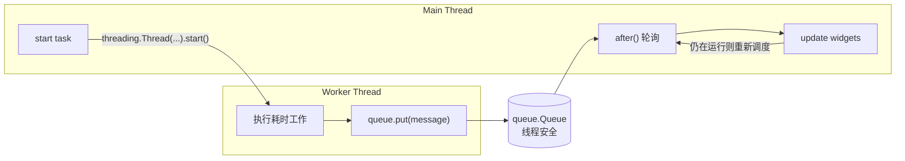
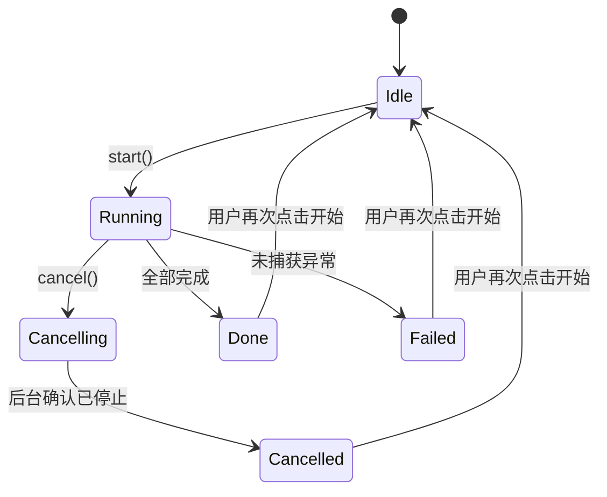

# Python Tkinter + ttk GUI 开发与 Mental Model 全套教程

> 面向有 C / C++ / Go / Rust 背景、正在学习 Python `Tkinter + ttk` 的工程师。
> 目标：建立 Tkinter + ttk GUI 开发的第一性原理 Mental Model，而不是背 API。
> 教学语言：中文。代码语言：Python 3。
>
> 姊妹教程：[tcl-tk-gui-mastery](../tcl-tk-gui-mastery/README.md)（原生 Tcl/Tk，不涉及 Python）。两套教程的目录结构、文档模板风格保持一致，方便对照阅读。

---

## 0. 环境与验证说明（请先读）

本教程的全部 `.py` 示例在**无图形显示环境（headless，没有 `$DISPLAY`）**的终端中编写和验证，验证方式如下：

1. 每个文件先用 `python3 -m py_compile <file>` 做语法检查，全部通过。
2. **不依赖 Tkinter 的纯逻辑部分**（Layer 7 的 `run_simulated_test`、Layer 8 的 `models.py`/`services/test_service.py` 全部内容）直接用 `python3` 完整运行并用 `assert` 断言验证，包括正常完成路径、取消路径、校验失败路径——这部分代码**不只是语法正确，而是真正运行验证过的**。
3. **依赖 Tkinter 的 GUI 文件**：在 headless 环境下运行，确认程序能顺利执行到 `tk.Tk()` 创建根窗口、尝试连接显示服务器的那一步才报错（`_tkinter.TclError: no display name and no $DISPLAY environment variable`），而不是在更早的位置出现语法错误、导入错误或逻辑错误。这证明脚本在 Tk 初始化之前的全部 Python 代码（类定义、函数定义、模块级常量、import 关系）都是合法且可执行的。

这意味着：**本教程所有 GUI 示例的 Python 语法和"界面构建之前"的逻辑已尽力核实，但实际的窗口外观、控件排布、点击效果，请你在有图形界面的机器上运行查看**。这正是学习 GUI 开发的必要步骤——光看代码和看运行效果是两种不同的理解，不能互相替代。

实际开发环境版本：

```bash
$ python3 --version
Python 3.10.18
$ python3 -c "import tkinter; print(tkinter.TkVersion, tkinter.TclVersion)"
8.6 8.6
```

本教程要求的目标版本是 Python 3.11+（见各示例文件头部说明），但所有代码**只使用 3.10/3.11 均兼容的语法**（没有使用任何 3.11 专属特性），因此在 3.10 环境下验证的结果对 3.11+ 同样成立。

---

## 1. 整体 Mental Model

### 1.1 总体架构图



**解释**：这是用于理解交互和任务流的逻辑图，不代表 Tkinter 的全部内部调用顺序。用户的动作（点击、打字、选择）先作用在具体的 Widget 上；Widget 把这个动作转换成 Tk 内部的一个事件，交给事件循环；事件循环根据这个 Widget 注册过的 `command=`/`bind()` 找到对应的回调函数并调用；回调函数（Application Logic）执行真正的业务代码——可能是直接计算，也可能是通过队列把工作丢给后台线程（Worker Thread），再由后台线程调用 Business Service 层的函数，最终触达文件系统、网络、SSH 或其他外部进程。

### 1.2 Widget Tree 图

```text
root (tk.Tk)                     <- 根窗口，Widget Tree 的根节点
├── Frame (toolbar)
│    ├── Button
│    └── Label
├── LabelFrame (form)
│    ├── Label
│    └── Entry
├── Notebook
│    ├── Frame (page 1)
│    │    └── Treeview
│    └── Frame (page 2)
│         └── Text
└── Toplevel (独立窗口，仍然依附于 root 的生命周期)
     └── Frame
          └── Button
```

**解释**：Widget Tree 描述的是"包含关系"（谁是谁的子控件），不是"屏幕上谁在上面谁在下面"（那是布局管理器的职责，见 [Layer 1](01-layout-widget-tree/README.md)）。`Toplevel` 是一个例外——它在操作系统层面是独立窗口，但在对象生命周期上仍然是 `root` 的子节点：`root` 被销毁时，所有 `Toplevel` 子窗口也会被自动销毁（见 [Layer 4](04-dialog-menu-notebook/README.md)）。

### 1.3 按钮点击时的事件时序图



**解释**：从用户点击到界面刷新，中间经过"事件产生 → 事件循环检测 → 调用回调 → 业务逻辑 → 更新状态/控件 → 重绘"这一条链路（见 [Layer 2](02-event-callback/README.md)）。整个过程都发生在**同一个线程**里，顺序执行，不会被其他事件打断——这也是为什么回调里的耗时代码会让界面"卡住"的根本原因（见 [Layer 6](06-after-timer/README.md) 和 [Layer 7](07-thread-queue/README.md)）。

### 1.4 后台任务与 UI 通信的数据流图



**解释**：这是一个经典的生产者-消费者模型（见 [Layer 7](07-thread-queue/README.md)）。Worker Thread 是生产者，只管干活、把消息丢进线程安全的 `queue.Queue`，对 Tkinter 一无所知；Main Thread 这一侧由 `after()` 周期性触发的轮询函数是消费者，负责取出消息并执行真正的 Widget 更新。这条路径是后台线程和 UI 之间**唯一**安全的通信渠道——后台线程绝不应该直接调用任何 Tkinter 对象的方法。

### 1.5 任务状态机图



**解释**：这张状态机图贯穿 [Layer 7](07-thread-queue/README.md) 和 [Layer 8](08-test-console-project/README.md)，在综合项目里被显式建模为 `models.TaskStatus` 枚举。核心原则是：`Running -> Cancelling` 只是"请求取消"，必须等后台线程真正确认停止（送回终态消息）才能进入 `Cancelled`；任何终态（`Done`/`Failed`/`Cancelled`）都要让界面恢复到可以重新点击"开始"的状态，不能卡在中间态。

---

## 2. 十个"为什么"（Prompt 第 3 节要求的问题清单）

| 问题 | 简答（详细解释见对应 Layer） |
|---|---|
| 为什么 GUI 需要 Event Loop？ | GUI 本质是对不确定到来的用户输入做出响应，事件循环是"等待 → 分发 → 执行"这个响应机制的具体实现。见 [Layer 0](00-architecture/README.md)。 |
| 为什么 `mainloop()` 通常是程序运行的中心？ | 调用它之前的代码只是"搭场景"，真正让窗口显示、响应点击的是这个循环本身；它会一直运行直到窗口关闭。见 [Layer 0](00-architecture/README.md)。 |
| 为什么按钮的 `command` 接收函数对象，而不是函数调用结果？ | `command=fn()` 会在创建控件的瞬间就执行一次 `fn`，并把返回值（通常是 `None`）赋给 `command`；只有传函数对象本身，Tk 才能在点击发生时才去调用它。见 [Layer 2](02-event-callback/README.md)。 |
| Widget Tree 是什么？Parent 与 Child 如何协作？ | 每个 Widget 创建时都要指定 parent，这决定了"归属关系"（销毁父节点连带销毁子节点），但不决定屏幕位置。见 [Layer 1](01-layout-widget-tree/README.md)。 |
| 布局管理器与 Widget Tree 是什么关系？ | Widget Tree 管"包含关系"，布局管理器管"空间分配"——同一个父容器下，布局决策独立于其他容器。见 [Layer 1](01-layout-widget-tree/README.md)。 |
| 为什么 `StringVar` 是一个变量对象，而不只是普通 Python 字符串？ | 因为它需要被多个控件"订阅"并自动保持同步，这是一种带观察者机制的共享状态节点，不是普通变量能做到的。见 [Layer 3](03-variables-form-binding/README.md)。 |
| 为什么 `after()` 可以调度未来的 UI 工作？ | `after()` 把回调注册进事件循环未来要检查的任务列表，到期后像处理普通事件一样被调用——它延迟的是"何时执行"，不改变"在哪个线程执行"。见 [Layer 6](06-after-timer/README.md)。 |
| 为什么长时间运行的任务会让窗口失去响应？ | 单线程事件循环任何时刻只能做一件事；一个回调如果同步阻塞很长时间，循环就没有机会处理其他事件（包括重绘和用户输入）。见 [Layer 6](06-after-timer/README.md)。 |
| 为什么后台线程不能直接修改 Tkinter 控件？ | Tk 内部的数据结构不是线程安全的，跨线程直接操作会导致数据竞争，表现为随机崩溃或界面错乱。见 [Layer 7](07-thread-queue/README.md)。 |
| 如何把 GUI 和业务逻辑解耦？ | 让业务规则（校验、模拟测试、数据结构）完全不 import Tkinter，只通过纯数据和线程安全队列与界面层交流；界面层只负责编排和展示。见 [Layer 8](08-test-console-project/README.md)。 |

---

## 3. 学习路径

```text
Hello Window
    |
    v
Widget Tree + Layout
    |
    v
Events + Callbacks
    |
    v
Variables + Forms
    |
    v
Dialogs + Multiple Pages
    |
    v
Treeview + Logs
    |
    v
after() + Timer
    |
    v
Thread + Queue
    |
    v
Engineering Test Console
```

严格按顺序阅读：Layer 3（变量绑定）和 Layer 7（线程+队列）是整个 Mental Model 的两大核心支柱，之后的内容都建立在它们之上。不要跳过 Layer 0/1/2 直接进入后面的内容——那些"看起来简单"的基础机制，恰恰是后续所有排错能力的来源。

| Layer | 主题 | 核心问题 | 目录 |
|---|---|---|---|
| 0 | 环境与最小 GUI | Tkinter/ttk/Tcl-Tk 是什么关系？`mainloop()` 为什么是中心？ | [00-architecture](00-architecture/README.md) |
| 1 | Widget Tree 与布局管理 | 控件怎么组织、怎么摆放？ | [01-layout-widget-tree](01-layout-widget-tree/README.md) |
| 2 | 事件系统与回调 | 用户动作怎么变成代码执行？ | [02-event-callback](02-event-callback/README.md) |
| 3 | 控件与变量绑定 | 状态怎么和界面自动同步？ | [03-variables-form-binding](03-variables-form-binding/README.md) |
| 4 | 对话框、菜单与多页面 | 什么时候开新窗口，什么时候切页面？ | [04-dialog-menu-notebook](04-dialog-menu-notebook/README.md) |
| 5 | Treeview 与日志查看器 | 怎么展示一批结构化数据？ | [05-treeview-log-viewer](05-treeview-log-viewer/README.md) |
| 6 | `after()` 与定时任务 | 怎么在不阻塞界面的前提下定时做事？ | [06-after-timer](06-after-timer/README.md) |
| 7 | 后台线程与线程安全 | 耗时任务怎么不卡住界面？ | [07-thread-queue](07-thread-queue/README.md) |
| 8 | 综合项目：自动化测试控制台 | 怎么把前面所有知识整合成真实工程？ | [08-test-console-project](08-test-console-project/README.md) |
| 9 | 常见错误与排查清单 | 遇到问题怎么快速定位？ | [09-debugging-checklist](09-debugging-checklist/README.md) |
| 10 | 概念关系表与跨语言类比 | 怎么用已有经验理解新概念？ | [10-concept-mapping](10-concept-mapping/README.md) |

---

## 4. 每个 Layer 的文档结构

每个 Layer 的 `README.md` 都遵循同一套结构（Prompt 第 5 节的 A~I 模板），方便你带着问题去读：

1. **Why** —— 这个机制解决什么问题
2. **Mental Model** —— 直觉说明 + 对象关系图/数据流图/时序图
3. **Architecture** —— 核心对象及其关系
4. **Complete Code** —— 完整可运行的 `.py` 文件
5. **Lifecycle** —— 启动、交互、回调执行、退出的完整过程
6. **Key APIs** —— 用表格说明 API / 作用 / 输入 / 输出副作用 / 常见错误
7. **Common Failure** —— 至少 3 个典型问题（现象/根因/定位方法/修复方案）
8. **Exercises** —— 1 个基础练习 + 1 个工程向练习
9. **Summary** —— 本层新增的 Mental Model，及与前序 Layer 的关系

---

## 5. 快速开始

```bash
cd tkinter-ttk-gui-mastery/00-architecture
python3 examples/00_hello_tkinter.py
```

如果你在本机（有图形界面）运行，应该看到一个标题为"Hello Tkinter"的窗口，里面有一行文字"Hello, Tkinter + ttk!"。这说明环境没有问题，可以开始学习。

综合项目的运行方式略有不同（需要先进入项目目录）：

```bash
cd tkinter-ttk-gui-mastery/08-test-console-project/tkinter-test-console
python3 app.py
```

如果你暂时没有图形界面环境（比如在 SSH 远程终端里），运行上述命令会在 `tk.Tk()` 这一行报 `_tkinter.TclError: no display name and no $DISPLAY environment variable`——这是**预期行为**，说明代码本身没有问题，只是缺少显示环境。请参考下面第 6 节的跨平台说明解决。

---

## 6. 跨平台说明

### 6.1 环境自检

```bash
# 任意平台通用：检查 tkinter 模块是否可用，以及 Tk 版本
python3 -c "import tkinter; print(tkinter.TkVersion, tkinter.TclVersion)"

# 官方自带的图形自检工具：应该弹出一个带有若干示例控件的小窗口
python3 -m tkinter
```

### 6.2 Linux

- 大多数发行版的系统 Python 不默认自带 Tk 支持，需要额外安装：
  - Debian/Ubuntu：`sudo apt install python3-tk`
  - Fedora/RHEL：`sudo dnf install python3-tkinter`
  - Arch：`sudo pacman -S tk`
- 需要一个可用的显示环境（`$DISPLAY` 非空）：本机桌面环境（X11 或 Wayland + XWayland）直接可用；SSH 远程登录需要 `ssh -X`/`ssh -Y` 开启 X11 转发；完全无显示的服务器/CI 环境可以用 `Xvfb :1 &; export DISPLAY=:1` 启动一个虚拟显示（看不到真实画面，但可以让 GUI 代码跑起来做自动化测试）。

### 6.3 macOS

- 系统自带的 Python 有时没有链接到 Tk 框架；推荐使用 python.org 官方安装包，或 `brew install python-tk` 为 Homebrew 安装的 Python 补上 Tk 支持。
- macOS 上 Tk 的外观渲染（尤其是 `ttk` 主题）和 Linux/Windows 有明显差异，属于正常现象，不代表代码有问题。

### 6.4 Windows

- 官方 python.org 安装包默认自带 Tcl/Tk 支持，一般不需要额外安装。
- `filedialog`/`messagebox` 等标准对话框在 Windows 上会呈现原生 Windows 风格，这是 `tkinter` 对各平台原生对话框的封装，属于预期行为。

### 6.5 本教程开发环境的特殊情况

本教程所有示例在**无显示环境的 Linux 容器/终端**中编写和验证（`$DISPLAY` 为空），采用第 0 节描述的"验证到 `Tk()` 调用前"的策略。这不代表 Tkinter 本身"不需要"显示环境——恰恰相反，这个限制清楚地说明了"GUI 程序离不开真实的显示服务器"这一基本事实，也是为什么本教程反复强调"请在有图形界面的机器上运行查看效果"。

---

## 7. 本教程不涉及的内容（刻意的范围边界）

遵循 80/20 原则，以下内容不在本教程覆盖范围内（遇到时可以查阅官方文档）：

- Tcl 解释器内部实现细节、Tk 的底层 C 实现。
- 罕见或过时的控件（如旧式 `tk.Button` 的大部分视觉定制选项，优先用 `ttk`）。
- 自定义 `ttk` 主题的样式表编写（`ttk.Style` 的深度定制）。
- 跨进程通信、打包分发（PyInstaller 等）、国际化（i18n）等与"GUI 事件/状态/线程"主线无关的工程话题。
