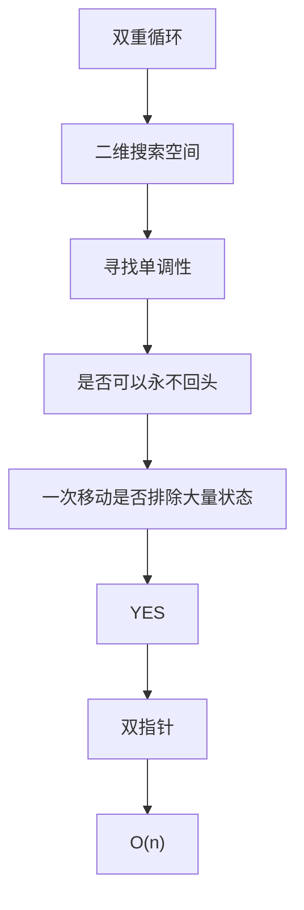

# 双指针统一心智模型

本教程不按刷题套路讲双指针。

目标只有一个：建立一条可以复用的判断链。

```
搜索空间 (Search Space)
      |
      v
单调性 (Monotonicity)
      |
      v
指针移动 (Pointer Movement)
      |
      v
状态剪枝 (State Elimination)
      |
      v
时间复杂度下降 (Complexity Reduction)
```

看到一道新题时，问的不是「这是不是双指针题」，而是：

1. 暴力在搜什么二维空间？
2. 这个空间里有没有单调性？
3. 一次指针移动能不能永久排除一整块状态？
4. 两个指针是否可以永不回头？

四个都成立，才是双指针。

---

## Table of Contents

| File | Topic |
|------|-------|
| [01-foundations.md](01-foundations.md) | 通用地基：搜索空间、单调性、剪枝、O(n) |
| [02-opposite-direction.md](02-opposite-direction.md) | 左右夹逼：利用有序性 |
| [03-sliding-window.md](03-sliding-window.md) | 滑动窗口：利用窗口性质单调变化 |
| [04-fast-slow.md](04-fast-slow.md) | 快慢指针：利用相对速度 |
| [05-two-sorted-arrays.md](05-two-sorted-arrays.md) | 双序列扫描：两个有序序列同时前进 |
| [06-read-write.md](06-read-write.md) | 读写指针：已处理区间永不回头 |
| [07-unified-mental-model.md](07-unified-mental-model.md) | 统一心智模型与分类判断 |

---

## Overview

```
+--------------------------------------------------------------+
|                  TWO POINTERS = STATE PRUNING                |
+--------------------------------------------------------------+
|                                                              |
|  暴力: 双重循环遍历全部 (i, j) 对                               |
|        搜索空间大小 = O(n^2)                                   |
|                                                              |
|  双指针: 利用单调性，每次移动排除一整块矩形                        |
|          每个指针最多走 n 步                                   |
|          总移动次数 <= 2n                                     |
|          搜索空间被线性扫完                                    |
|                                                              |
+--------------------------------------------------------------+
```

五种形态只是「二维空间怎么剪」的五种几何形状，不是五种技巧。

```
双重循环
      |
      v
二维搜索空间
      |
      v
寻找单调性
      |
      v
是否可以永不回头
      |
      v
一次移动是否排除大量状态
      |
      v
     YES
      |
      v
     双指针
      |
      v
     O(n)
```



---

## 五类对照

| 类型 | 二维空间的两个轴 | 单调性来自哪里 | 指针为什么不回头 |
|------|------------------|----------------|------------------|
| 左右夹逼 | 左下标 i，右下标 j | 数组有序，或宽度/高度单调 | 丢掉的一侧已被证明更差 |
| 滑动窗口 | 左端 L，右端 R | 窗口扩大/缩小后性质单向变化 | 已不合法的左端以后也不合法 |
| 快慢指针 | 慢位置 s，快位置 f | 相对距离只增不减，或周期相遇 | 相对速度决定轨迹不可逆 |
| 双序列扫描 | 序列 A 下标，序列 B 下标 | 两边都递增 | 更小的那一侧已被比较完 |
| 读写指针 | 读位置 r，写位置 w | 已处理前缀已经定型 | 写过的区间是最终答案前缀 |

---

## How to Read

先读 [01-foundations.md](01-foundations.md)，把「搜索空间 / 单调性 / 剪枝 / 2n」四个词钉死。

再按自己最不熟的一类读 02 到 06。每一类都按同一七段式写：

1. 它解决什么问题
2. 二维搜索空间
3. 单调性
4. 指针移动规则
5. 复杂度为什么下降
6. 统一心智模型
7. 五个完整例子

最后读 [07-unified-mental-model.md](07-unified-mental-model.md)，用统一判断表把五类收束成一个决策过程。
