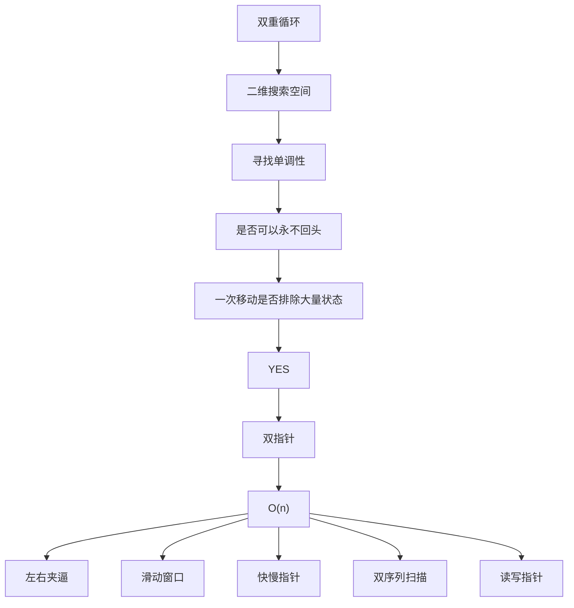

# 《双指针统一心智模型》

五章看完，不再按题型记，按这一张图判断。

---

## ① 所有双指针共同本质

双指针不是两种下标的舞蹈。

它是：

> 暴力在枚举一个二维状态空间。
> 空间里存在单调方向。
> 沿这个方向移动一个指针，可以永久删除一整块状态。
> 两个指针各自最多把轨道走完一遍。

一句话：

```
双指针 = 带证明的状态剪枝
```

五种形态只是剪块的几何不同：

| 类型 | 剪掉的是什么块 |
|------|----------------|
| 左右夹逼 | 上三角里的一行或一列 |
| 滑动窗口 | 固定右端时，过期的左端整列 |
| 快慢指针 | 除相对速度射线以外的所有位置对 |
| 双序列扫描 | 当前极值所在的行或列相对面后缀 |
| 读写指针 | 已冻结前缀的回写，以及被丢弃源列 |

实现都长成「两个下标」，原因只是：二维空间的两个轴正好用两个指针来标前沿。

---

## ② 为什么都是在搜索二维空间

几乎所有被叫做双指针的题，候选都不是单个元素。

```
一对下标        (i, j)     两数、容器、镜像
一段区间        (L, R)     子数组、子串
两个序列进度    (i, j)     归并、交、差
两个角色位置    (r, w)     过滤、压缩
两个轨迹位置    (s, f)     中点、环、倒数
```

格子数是 O(n^2) 或 O(n*m)。
双重循环是这个空间的诚实遍历。

双指针没有缩小「问题定义」，它缩小的是「必须踏进的格子」。

```
        轴2
         -->
      +-----------+
轴1   | # # # # # |
 |    | # # # # # |    # = 定义上的候选
 v    | # # # # # |
      +-----------+

双指针只沿着一条前沿走，
每一步用单调性把一大片 # 涂成死。
```

若你画不出这两个轴，先别写两个指针。
先问：暴力的两重循环分别在枚举什么。

---

## ③ 为什么都有单调性

没有单调性，踏过一个格子推不出邻居的死活。
指针移动就只是「换一个格子看看」，复杂度不降。

单调性是一句可证伪的话：

> 固定一个轴，另一个轴朝某方向走，目标量只朝一个方向变。
> 因此当前这一侧的整块区域同罪或同赦。

五类各自的单调对象：

```
+------------------+----------------------------------+
| 左右夹逼         | 有序和 / 宽度收缩下的短板上界         |
| 滑动窗口         | 窗口统计量随扩张变紧、收缩变松         |
| 快慢指针         | 相对距离或环上相位                   |
| 双序列扫描       | 两个后缀的 min/max                  |
| 读写指针         | 已完成前缀的名次 / 正确性             |
+------------------+----------------------------------+
```

共同句式：

```
若现在已经「太大 / 太脏 / 太小 / 已完成 / 相位未到」
则同一侧所有尚未访问的邻居只会更严重
于是这一侧整块死亡
```

数组有序只是单调性的一种来源，不是唯一来源。
窗口势函数、相对速度、名次计数，都是单调性。

单调性破了，算法必须换：

```
窗口求和但有负数     -> 滑窗最短和失败
无序 Two Sum         -> 夹逼失败，改哈希
keep(x) 依赖未来     -> 读写前缀失败
```

---

## ④ 为什么每次移动都是剪枝

如果一次移动只丢掉当前这一个格子，走 O(n) 步只能看 O(n) 个格子，
剩下 O(n^2) 没看，正确性就没了——除非那些没看的已经被这次移动间接宣判。

所以「移动」在逻辑上必须等于：

```
当前前沿 (i, j)
        |
        |  单调性给出判决
        v
处死一行 / 一列 / 一个矩形 / 射线外全部
        |
        v
前沿挪到剩余活区的新角上
```

图：

```
移动前                    移动后 (j--)

. . . . *                . . . * X
. . . . *                . . . * X
. . * . *                . . * . X
. . . . *                . . . . X

* 活   X 新死
不是少看 1 格，是少看 1 列
```

「不会漏解」的证明模板永远是：

> 被处死的块里，没有任何格子还能成为更优 / 合法答案。

「不用回退」的证明模板永远是：

> 被处死的块对未来所有更大/更小的另一轴，仍然死。
> 死人不会复活。

反向移动的典型失败：

```
复活死人 + 活埋尚未检查的格子
= 既可能死循环，也可能漏解
```

---

## ⑤ 为什么最终都是两个指针都只走一遍

每个指针被绑在一根轨道上，轨道有限，方向单向。

```
left / slow / i / write   : 最多 n 次 +1（或 -1）
right / fast / j / read   : 最多 n 次（fast 的 next 次数仍 O(n)）

循环每步至少推动一个指针
步数 <= 轨道1 + 轨道2 <= 2n
```

二维解释：

```
O(n^2) 格子
    被一条长度为 O(n) 的单调前沿扫过
    前沿每点 O(1) 维护统计量
    => O(n)
```

这就是复杂度下降的全部原因。
不是「感觉比较快」，是访问点数从平方变成线性。

若某个指针会回头，轨道长度不再有 n 的上界，2n 论证失效。

---

## 看到新题时怎么分类

按这个顺序问，不要先猜模板名。

```
步骤 1  暴力的两重循环枚举的是哪两个轴？
        画格子。

步骤 2  固定一个轴，另一个轴上目标量单调吗？
        写出那句话。写不出来就停下。

步骤 3  一次移动能处死一整块吗？
        块是行、列、窗口左侧，还是射线外？

步骤 4  死人以后会不会因为另一轴继续走而复活？
        会 -> 不是双指针。
        不会 -> 指针可以永不回头。

步骤 5  两个轨道是否各长 O(n)？
        是 -> O(n) 或 O(n+m)。
```

用几何对号入座：

```
两个端点, 有序或短板          -> 左右夹逼
连续一段, 统计量可增减        -> 滑动窗口
同一条 next, 相对关系         -> 快慢指针
两个有序序列要对齐            -> 双序列扫描
原地稳定过滤 / 压缩           -> 读写指针
```

交叉题很正常。
有序去重同时是夹逼思想 + 读写实现。
合并区间同时是排序后的序列扫描 + 写指针冻结。
分类看**主要剪枝来源**，不看变量叫 left 还是 i。

---

## 统一思维导图

ASCII：

```
双重循环
      |
      v
二维搜索空间
      |
      v
寻找单调性
      |
      v
是否可以永不回头
      |
      v
一次移动是否排除大量状态
      |
      v
    YES
      |
      v
    双指针
      |
      v
    O(n)
```

展开后的决策：

```
双重循环枚举 (轴1, 轴2)
            |
            v
        画出格子
            |
            v
     格子上有没有单调方向?
            |
     +------+------+
     |否           |是
     v             v
  老实枚举     一次移动能否
  或换别的     处死一整块?
  算法              |
             +------+------+
             |否           |是
             v             v
          仍是平方      死人会复活?
                           |
                    +------+------+
                    |会           |不会
                    v             v
                 需要栈/      两个指针
                 回溯/       各走一遍
                 别的结构         |
                                 v
                              双指针 O(n)
                                 |
         +-----------+-----------+-----------+-----------+
         |           |           |           |           |
         v           v           v           v           v
      左右夹逼    滑动窗口    快慢指针    双序列      读写
      有序/短板   窗口势      相对速度    两头极值    前缀冻结
```

Mermaid：



五类对照（判定用）：

```
+--------------+------------------+------------------+------------------+
| 类型         | 两个轴           | 单调对象         | 不回头的原因     |
+--------------+------------------+------------------+------------------+
| 左右夹逼     | 左端, 右端       | 有序和/短板上界  | 死行死列不复活   |
| 滑动窗口     | 左端, 右端       | 窗口统计量       | 过期左端更过期   |
| 快慢指针     | 慢位置, 快位置   | 相对距离/相位    | 时间与 next 单向 |
| 双序列扫描   | A进度, B进度     | 两后缀极值       | 已消耗极值已结算 |
| 读写指针     | 读位置, 写名次   | 前缀正确性       | 名次只追加       |
+--------------+------------------+------------------+------------------+
```

---

## 最后钉死的四句话

1. 先画格子，再谈指针。
2. 指针移动必须对应一块死亡证明。
3. 能复活就不是双指针。
4. O(n) 来自两条单向轨道，总长 2n。

能在新题上把这四句说圆，这一类算法就不再是套路，而是第一性原理。
