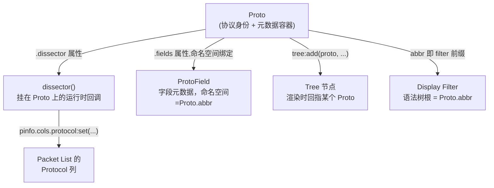

# 第一部分：Why — 为什么一切从 Proto 开始

## 1.1 先回答一个更基础的问题：Wireshark 到底是什么架构

在问"为什么是 Proto"之前，先回忆 [Wireshark 解析 Packet 的通用流程与心智模型](../../wireshark_parser_flow.md) 里的结论：

> Wireshark 本质上就是一个 **Dissector 调度器（Dispatcher）**。每一层协议解析完 Header 后，找到"下一层协议是谁"，再调用下一个 Dissector。

```
Frame
  |
  v
Ethernet dissector
  |  (EtherType = 0x0800)
  v
IPv4 dissector
  |  (Protocol = 6)
  v
TCP dissector
  |  (Port = 80)
  v
HTTP dissector
  |
  v
Your Proto
  |
  v
Sub Dissector（例如内层还有别的协议）
```

这条链上每一个节点，在 Wireshark 内部都不是一个裸的"函数"，而是一个**注册在全局表里的对象**。这个对象就是 `Proto`。

## 1.2 为什么不是 packet / parser / decoder / handler / callback

如果只是要"解析一段字节"，你确实只需要一个函数：`function dissect(bytes) -> fields`。C 语言写个 `parse_xxx()`，Python 写个 `decode()`，都够用。但 Wireshark 要解决的不是"解析一次"，而是下面这一整套长期存在的问题：

```
+--------------------------------------------------------------+
|  只有一个 "解析函数" 无法回答的问题                              |
+--------------------------------------------------------------+
|  1. 这个协议在 Filter 里叫什么名字？(tcp.port == 80 是怎么来的)  |
|  2. 这个协议在 Preferences 对话框里怎么配置？                     |
|  3. 用户右键 "Decode As" 时，下拉列表里显示的是什么？              |
|  4. 这个协议有多少个字段？每个字段的类型/说明是什么？               |
|  5. 别的协议（TCP/UDP）怎么知道"该把包转给我解析"？                 |
|  6. 我怎么把自己挂到已有协议下面，又允许别人把新协议挂到我下面？      |
|  7. Packet List 里的 "Protocol" 列要显示什么？                    |
+--------------------------------------------------------------+
```

这些问题的共同点是：它们都不是"运行时解析逻辑"，而是**协议的静态身份（identity）+ 注册信息（registration）**。

`packet` / `parser` / `decoder` / `handler` / `callback` 这几个名字，描述的都是"运行时做什么"（动词性质）。而 Wireshark 需要一个"名词性质"的对象，来同时承载：

- 身份（我是谁：name、abbreviation）
- 元数据（我有哪些字段、哪些 Preferences、哪些 Expert Info）
- 注册凭证（我在 filter 系统、Decode As 列表、Packet List 里分别对应什么）
- 一个可选的运行时函数指针（dissector）

这个对象就是 `Proto`。`dissector()` 只是挂在 `Proto` 身上的**一个属性**，而不是相反。

```
错误的心智模型：
    dissector 函数是主角，Proto 只是传给它的一个参数

正确的心智模型：
    Proto 对象是主角（协议的注册表条目）
    dissector 函数只是 Proto 身上的一个可选回调属性
    Proto.dissector = function(tvb, pinfo, tree) ... end
```

## 1.3 Proto 在 Packet Dissection Pipeline 中的位置

```
Frame
  |
  v
Ethernet   ---- Proto: eth      (Wireshark 内建, C 实现)
  |
  v
IP         ---- Proto: ip       (Wireshark 内建, C 实现)
  |
  v
TCP        ---- Proto: tcp      (Wireshark 内建, C 实现)
  |
  v
Your Proto ---- Proto: mydns    (你用 Lua 创建并注册)
  |
  v
Sub Dissector ---- Proto: ...   (可能还是别人的 Lua/C Proto)
```

内建协议（Ethernet/IP/TCP）在 C 层做的事情，跟你用 Lua 创建 `Proto("mydns", "MyDNS Protocol")` 做的事情，**是同一套机制**：

1. 向全局 Protocol Registry 注册一个协议条目
2. 声明这个协议有哪些字段（用于 Tree 展示 + Filter 语法）
3. 把自己的 dissector 挂到某个上游协议的 `DissectorTable` 里（"我处理 udp.port == 65333"）
4. 收包时，上游协议查表，调用你的 dissector

Lua 的 `Proto` 就是这套 C 层机制在脚本层的一比一映射。这也是为什么官方文档把它叫做"允许 Lua 脚本创建新协议（Proto protocol objects）"——它不是"写一个解析函数"，而是"新增一个跟内建协议同等地位的协议"。

## 1.4 Proto 与其它对象的关系

### Proto ↔ Dissector

```
Proto (mydns)
  |
  +-- .dissector = function(tvbuf, pktinfo, root) ... end
```

`dissector` 不是一个独立概念，它是 `Proto` 的一个字段。你甚至可以把同一个函数赋给多个 Proto，或者把一个 Proto 注册成 heuristic dissector、postdissector——**运行时角色是可以叠加/替换的，但身份(Proto)只有一个**。这就是为什么第四部分要单独讲"Dissector Registry / DissectorTable / Decode As / Heuristic / PostDissector"——它们都是"如何触发某个 Proto 的 dissector 属性被调用"的不同机制，而不是不同的对象体系。

### Proto ↔ ProtoField

```
Proto (mydns)
  |
  +-- .fields = { pf_trans_id, pf_flags, pf_query, ... }
        |
        +-- 每个 ProtoField 的 abbreviation 都必须以 "mydns." 开头
            例如: mydns.trans_id, mydns.flags.response
```

`ProtoField` 描述的是"字段的元数据"（类型、显示格式、说明文字），但它**必须绑定在某个 Proto 的命名空间下**——filter 里能不能写 `mydns.trans_id == 1`，靠的就是这层绑定。没有 Proto，ProtoField 连名字都起不了（因为名字的前缀就是 Proto 的 abbreviation）。

### Proto ↔ Tree

```
root:add(dns, tvbuf:range(0,pktlen))
       |
       +-- 这里的第一个参数就是 Proto 对象本身
       +-- Tree 用它来决定：这个子树显示成什么名字、用什么图标、
           右键菜单里 "Decode As" 显示什么、能不能被 "Apply as Column"
```

`tree:add(dns, ...)` 里传进去的 `dns` 就是那个 `Proto` 对象——Tree 渲染一个子树节点时，需要知道"这个节点代表哪个协议"，答案永远是回指到某个 `Proto`。

### Proto ↔ Filter

```
Proto("mydns", "MyDNS Protocol")
        |
        +-- abbreviation "mydns" 直接变成 Display Filter 的命名空间前缀
                |
                +-- mydns              (协议本身是否存在)
                +-- mydns.trans_id      (某个 ProtoField)
                +-- mydns.flags.response
```

Display Filter 语法树本质上是一棵按"协议名.字段名"组织的命名空间树，根节点永远是某个 `Proto` 的 abbreviation。这也解释了为什么 `ProtoField` 的名字规范强制要求带 `<protoname>.` 前缀——那不是风格建议，是整套 filter 系统能工作的前提。

### Proto ↔ Packet List

```
Packet List 表格
+------+-----------+----------+----------+----------------------+
| No.  | Time      | Source   | Protocol | Info                 |
+------+-----------+----------+----------+----------------------+
| 1    | 0.000000  | 1.2.3.4  | MYDNS    | (42) Query a.com     |
+------+-----------+----------+----------+----------------------+
                        ^
                        |
                pinfo.cols.protocol:set("MYDNS")
                （这行代码通常写在某个 Proto 的 dissector() 里）
```

"Protocol" 这一列显示的字符串，几乎总是在某个 Proto 的 dissector 函数里通过 `pinfo.cols.protocol` 设置的——它把"当前这个包最终由谁负责解析"这件事，用一行文本呈现给用户，而这个"谁"，指的就是某个 Proto。

## 1.5 一张图总结这五种关系



## 1.6 为什么 Proto 是整个 Lua API 的入口

把上面几条关系叠在一起看，会发现一个共同规律：**每一种其它对象，都需要先有一个 Proto 才能存在或者才有意义。**

```
没有 Proto  --->  ProtoField 起不了合法的名字（没有命名空间前缀）
没有 Proto  --->  Preferences 挂不到 Wireshark 的 Preferences 对话框上
没有 Proto  --->  DissectorTable 不知道该把哪个 dissector 关联进去
没有 Proto  --->  ProtoExpert 不知道该归属到哪个协议的过滤体系
没有 Proto  --->  Tree 里的节点显示不出协议名字
没有 Proto  --->  Filter 语法树没有根节点
```

反过来，`Proto` 本身在被创建的那一刻（`local dns = Proto("mydns", "MyDNS Protocol")`），什么都还没发生——它只是往全局 Protocol Registry 占了一个位置。真正让它"活起来"的，是后续一系列**围绕这个 Proto 对象的赋值和注册调用**：

```
local dns = Proto("mydns", "MyDNS Protocol")   -- 1. 拿到身份
dns.fields = { ... }                            -- 2. 声明字段（挂在身份上）
dns.prefs.port = Pref.uint(...)                 -- 3. 声明配置项（挂在身份上）
dns.experts   = { ... }                          -- 4. 声明专家信息（挂在身份上）
function dns.dissector(tvbuf, pktinfo, root)     -- 5. 声明运行时行为（挂在身份上）
    ...
end
DissectorTable.get("udp.port"):add(65333, dns)  -- 6. 把身份注册进上游的调度表
```

这就是为什么 Wireshark Developer's Guide 把整章 Lua 新协议 API 命名为"Functions For New Protocols And Dissectors"，并且开篇第一句话就是"`Proto` protocol objects can have `Pref` preferences, `ProtoField` fields ..."——句式结构已经把 `Proto` 放在主语位置，其它一切都是它的从属物（can have）。

**一句话总结：Proto 不是"协议解析的一种实现方式"，Proto 就是"协议"在 Wireshark 世界里的存在形式本身。所有其它 Lua API，本质上都是"如何往一个 Proto 对象上挂东西、以及如何让别人找到这个 Proto"。**

理解了这一点，第二部分讲"一个 Plugin 里到底有哪些对象"时，你会发现它们几乎都能归类成两种角色之一：**挂在 Proto 上的东西**，和**帮 Proto 被找到/被调用的东西**。
