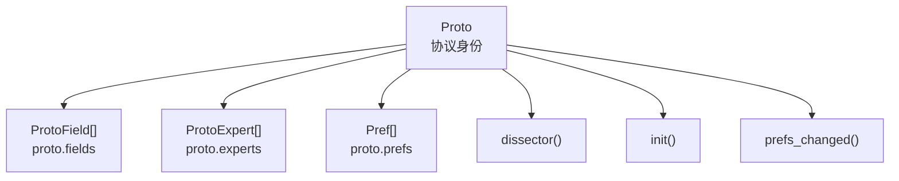
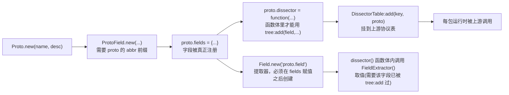
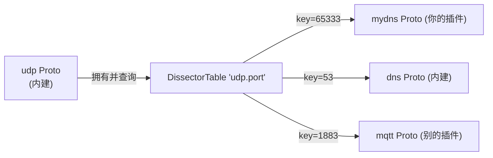

# 第二部分：Architecture — 一个 Lua Plugin 里到底有哪些对象

## 2.1 先别看 API，先看"角色"

延续第一部分的结论——Proto 是身份，其它对象分两类：

```
+------------------------------------------------------------+
|  A 类：挂在 Proto 身上的东西（Proto 拥有它们）                  |
|        ProtoField / Preferences / ProtoExpert / dissector() |
|                                                             |
|  B 类：帮 Proto 被找到 / 被调用的东西（它们指向 Proto）          |
|        DissectorTable / Decode As / Heuristic 注册 /        |
|        PostDissector 注册 / Conversation 绑定                |
+------------------------------------------------------------+
```

再加上两类跟"单个 Proto"关系不大、而是跟"整个抓包会话"打交道的对象：

```
+-------------------------------------------------------------+
|  C 类：Packet Runtime 对象（每包都会用到，生命周期=一个包）       |
|        Tvb / TvbRange / Pinfo / TreeItem / ByteArray /      |
|        Address / NSTime                                     |
|                                                             |
|  D 类：跨包 / 跨 Plugin 的基础设施（生命周期=整个 capture 或更长）|
|        Conversation / Field 提取器 / Listener(Tap) / GUI 菜单 |
+-------------------------------------------------------------+
```

## 2.2 单个 Plugin 内部的对象树

```
Plugin (一个或多个 .lua 文件)
  |
  +-- Proto                          描述层：这是什么协议
  |     +-- ProtoField[]             字段元数据（决定 Tree 显示 + Filter 语法）
  |     +-- ProtoExpert[]            专家信息元数据（决定 Expert Info 面板)
  |     +-- Pref[]  (proto.prefs)    配置项元数据（决定 Preferences 对话框）
  |     +-- dissector()              运行时：收到包时执行什么
  |     +-- init()                   运行时：capture 打开/重新解析时执行什么
  |     +-- prefs_changed()          运行时：用户改了 Preferences 时执行什么
  |
  +-- DissectorTable                 注册层：把 Proto 挂到"谁的下面"
  |     +-- :add(port_or_key, proto)         挂靠端口/类型值
  |     +-- :add_for_decode_as(proto)        出现在 "Decode As" 列表里
  |
  +-- register_postdissector(proto)  注册层：把 Proto 挂到"每包解析完之后"
  +-- proto:register_heuristic(...)  注册层：把 Proto 挂到"启发式候选列表"
  |
  +-- Field.new(...)                 运行时：只读地取别的 Proto 已经解析出的字段值
  +-- Listener.new(...) / Tap        统计层：不改 Tree，只做统计/画图
  +-- register_menu(...)             GUI 层：往 Tools/Statistics 菜单挂一个入口
  +-- TextWindow / new_dialog        GUI 层：弹窗、展示自定义内容
```

## 2.3 按六大类给对象分类

```
+----------------+----------------------------------------------------+
| 分类            | 包含对象                                            |
+----------------+----------------------------------------------------+
| 描述层           | Proto, ProtoField, ProtoExpert                     |
| (metadata)      |                                                    |
+----------------+----------------------------------------------------+
| 注册层           | DissectorTable, register_postdissector,            |
| (registration)  | register_heuristic, add_for_decode_as, Pref        |
+----------------+----------------------------------------------------+
| Packet Runtime  | Tvb, TvbRange, Pinfo, TreeItem, ByteArray,         |
|                 | Address, NSTime, Field/FieldInfo                   |
+----------------+----------------------------------------------------+
| GUI             | register_menu, TextWindow, new_dialog,             |
|                 | gui_enabled()                                      |
+----------------+----------------------------------------------------+
| Statistics      | Listener(Tap), tap.packet/tap.draw/tap.reset       |
+----------------+----------------------------------------------------+
| Utility         | ByteArray 编解码、Dissector.get()、Struct 打包/解包  |
+----------------+----------------------------------------------------+
```

> 说明：这里用 ASCII 表格而不是 Mermaid，是因为它只是"分类罗列"，没有节点间的连线/流向关系需要表达；下面涉及依赖方向的部分改用 Mermaid。

## 2.4 对象关系图（Proto 为中心）



## 2.5 依赖图（谁必须先存在，谁才能被创建/调用）



这张图里有两条容易被忽略、但极其重要的顺序约束（对应第九部分"踩坑"）：

1. `Field.new("proto.field")` 必须写在 `proto.fields = {...}` 赋值语句**之后**，且不能写在 `dissector()` 函数体内部（Lua 官方注释在 `dns_dissector.lua` 里专门强调了这一点，见 [06-case-study-dns-dissector.md](06-case-study-dns-dissector.md)）。
2. 用 `Field` 提取器读一个字段的值，前提是这个字段在**当前包**已经被某个 `tree:add(field, ...)` 调用写入过——Field 提取器读的是"已经产生的解析结果"，不是"字段的定义"。

## 2.6 DissectorTable 是"路由表"，不是"协议"

初学者常把 `DissectorTable` 和 `Proto`搞混。区分方式：

```
Proto            ==  一个协议的身份证
DissectorTable   ==  一张"某个字段值 -> 该交给哪个 Proto 处理"的路由表

例：
DissectorTable "udp.port"
  65333  -> mydns Proto
  53     -> Wireshark 内建 dns Proto
  1883   -> mqtt Proto
  ...
```



一个 `DissectorTable` 由某个协议创建并"拥有"（例如 `udp` 协议自己在 C 层创建了 `udp.port` 这张表），任何协议（不管是 C 写的还是 Lua 写的）都可以往里面 `add` 自己。你自己的 Proto 也可以反过来创建一张新表（`DissectorTable.new(...)`），让别的协议挂进来——这正是第六部分案例3 `RLS-wireshark-dissector` 的核心手法：它创建了一张名为 `"rls"` 的表，用于按版本号分发给不同的子协议实现。

## 2.7 Tree 和 Packet 的关系

```
Packet (一次 dissector 调用的隐含上下文)
  |
  +-- Tvb          原始字节，只读
  +-- Pinfo         这次解析过程中积累的元信息（列文本、地址、conversation 等），可读可写
  +-- TreeItem (root)   Tree 的根节点，dissector 的第三个参数
        |
        +-- root:add(proto, tvbrange) 返回一个子 TreeItem
              |
              +-- subtree:add(protofield, tvbrange) 继续往下挂子节点
```

`Tree` 不是一个全局单例对象，而是**每个包单独构造出来的一棵树**；`Proto` 和 `ProtoField` 只是决定"这棵树的某个节点该长什么样、能不能被过滤"的元数据来源。这就是为什么第五部分要把 Tree 归类为"每包新建"，而 Proto/ProtoField 归类为"整个 capture 共用"——它们的生命周期完全不同，但经常被初学者误认为"是一个东西"。

下一部分（[03-lifecycle.md](03-lifecycle.md)）会把这些对象按"什么时候创建/销毁"串成一条完整的时间线。
