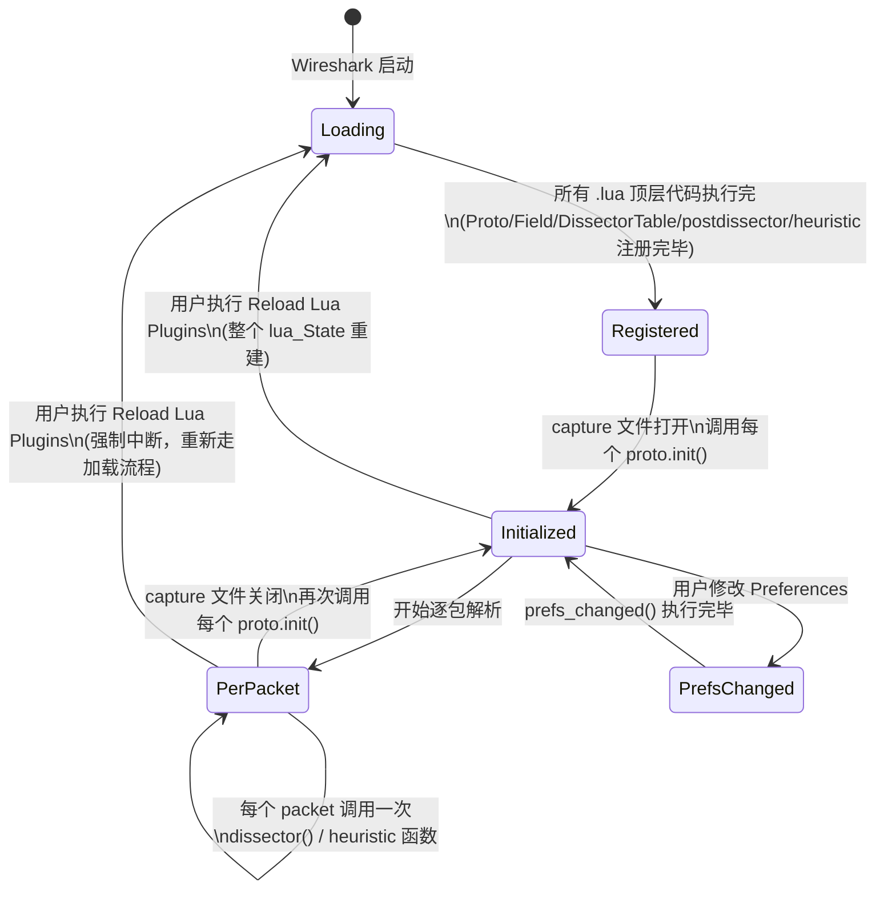

# 第三部分：Lifecycle — 一个 Lua Plugin 的完整生命周期

## 3.1 全局时间线

```
Wireshark / Tshark 启动
        |
        v
初始化 EPAN 库，加载并注册所有 C 编译的 Dissector（内建协议）
        |
        v
初始化 Lua 引擎（一个持久的 lua_State）
        |
        v
按固定顺序加载 .lua 文件（见 3.2）——这一步会执行每个文件的"顶层代码"
        |
        v
顶层代码里发生的事：Proto.new() / ProtoField.new() / DissectorTable.add() /
                    register_postdissector() / register_heuristic() / register_menu()
        |
        v
所有 .lua 文件加载完毕，Lua 侧的注册阶段结束
        |
        v
------------------ 等待用户打开一个 capture / 开始抓包 ------------------
        |
        v
【capture 打开事件】对所有定义了 proto.init 的 Proto，调用一次 init()
        |
        v
------------------------- 逐包解析循环 -------------------------
        |
        v
  收到 Packet -> 上游 Dissector 查表 -> 命中你的 Proto -> 调用 dissector(tvb,pinfo,tree)
        |
        v
  （可选）heuristic 分支 / postdissector 分支 / conversation 直连分支
        |
        v
  构建 Tree -> Packet Details / Packet List 渲染
        |
        v
------------------------- 循环直到抓包结束 -------------------------
        |
        v
【capture 关闭事件】再次调用一次 init()（官方文档原话：
  "called when a new capture file is opened OR when the open capture file is closed"）
        |
        v
（可选）用户修改 Preferences -> 调用 prefs_changed()
        |
        v
（可选）用户执行 "Analyze > Reload Lua Plugins" (Ctrl+Shift+L)
        |
        v
整个 lua_State 被销毁重建，回到"按固定顺序加载 .lua 文件"这一步重新跑一遍
```

## 3.2 加载阶段的细节：顺序为什么重要

Wireshark 官方文档（`wsluarm.html`）对加载顺序有非常具体的规定，这是理解"多文件 Plugin 为什么要这样组织"的关键：

```
1. 先尝试加载 全局 plugins 目录下的 init.lua
2. 再尝试加载 个人 plugins 目录下的 init.lua
3. 加载 全局 plugins 目录及其子目录下 所有 *.lua （ASCIIbetical 顺序，逐层深入子目录）
4. 加载 个人 plugins 目录及其子目录下 所有 *.lua （同样的顺序规则）

特殊规则：如果某个子目录里包含 init.lua，这个子目录被当作一个"包(package)"，
         Wireshark 只加载这个 init.lua，其余文件由这个 init.lua 自己决定要不要 require。
```

更重要的是这一句（直接决定了你写多文件插件时该注意什么）：

> Lua 的 dissector 跟 C 编译的 dissector 不一样，**目前还没有"注册阶段"和"关联/handoff阶段"的区分**——每个 Lua 文件的注册和 handoff 是在移动到下一个文件之前就完成的。这意味着 **Lua 文件被读取的顺序非常重要**：如果一个 Lua dissector 要注册进另一个 dissector 建立的 DissectorTable，后者必须已经先被处理过。

```
+-------------------------------------------------------------+
|  Lua 顶层代码（Proto.new / DissectorTable.new / add 等）      |
|  是"边读文件边执行"的，不是"全部文件读完再统一执行"              |
|                                                              |
|  file_a.lua:  DissectorTable.new("myproto.subtype", ...)      |
|  file_b.lua:  DissectorTable.get("myproto.subtype"):add(1,X)  |
|                                                              |
|  只有当 file_a.lua 在 ASCIIbetical 顺序上排在 file_b.lua 之前，  |
|  这段代码才不会因为表还不存在而报错。                            |
+-------------------------------------------------------------+
```

这也是为什么很多真实项目会用数字前缀命名文件（`00_common.lua`, `01_entry.lua`, `10_plugin_a.lua`），或者把"建表的文件"命名得比"往表里加东西的文件"更靠前——这不是风格问题，是**加载时机的强制约束**。

案例3 [08-case-study-rls-dissector.md](08-case-study-rls-dissector.md) 里的 `rls.lua`（建表）能正确工作，靠的恰好是另一条规则：**`init()` 函数体内的代码不在"顶层执行"阶段跑，而是延后到"capture 打开"事件才统一执行**（见 3.3），所以 `protocol/rls-3-1.lua` 在自己的 `init()` 里调用 `DissectorTable.get("rls")` 时，`rls.lua` 的顶层代码（创建这张表）早已在加载阶段跑完，不受两个文件谁先谁后加载的影响。**这正是"顶层代码"和"init() 回调"这两种时机的本质区别。**

还有一条常被忽略的规则：**Lua 代码在所有 C 编译的 dissector（内建 + C 插件）初始化完毕之后、读取任何文件之前执行**。所以 Lua dissector 可以把自己加进内建协议建立的表（如 `udp.port`），但反过来，C dissector 不可能加进 Lua dissector 创建的表——这条单向依赖，解释了为什么"获取已有 Dissector/Table"永远是 Lua 插件单方面的动作。

## 3.3 状态机视角



## 3.4 "什么时候执行一次 vs 什么时候每包执行"对照

```
只执行一次（Lua 文件加载时，顶层代码）：
    Proto("name","desc")
    ProtoField.new(...)
    proto.fields = {...}
    proto.experts = {...}
    dns.prefs.port = Pref.uint(...)
    DissectorTable.get("udp.port"):add(port, proto)
    proto:register_heuristic("udp", func)
    register_postdissector(proto)
    register_menu(...)
    Field.new("proto.field")          -- 提取器对象本身只创建一次

capture 打开/关闭各执行一次：
    proto.init()                       -- 用来重置/清空跨包缓存状态（见12-common-pitfalls.md）

用户改配置时执行一次：
    proto.prefs_changed()              -- 典型用途：端口变了，要在 DissectorTable 里先 remove 旧端口再 add 新端口

每个 packet 执行一次：
    proto.dissector(tvb, pinfo, tree)
    heuristic 函数
    postdissector 的 dissector 函数
    tap.packet(pinfo, tvb, tapinfo)    -- Listener/Tap 的每包回调

抓包/文件读取结束后执行一次（如果注册了）：
    tap.draw()                          -- 统计类 Tap 用来"汇总输出"的时机

用户主动触发才执行：
    整个 Reload 流程                     -- Ctrl+Shift+L，重新走一遍"加载阶段"
```

## 3.5 为什么这套生命周期设计成这样

三个设计目的贯穿始终：

1. **注册与运行分离**：顶层代码只负责"声明有哪些协议/字段/表"，不负责"处理某一个具体的包"——这保证了 Wireshark 可以在打开任何 capture 文件之前，先把整个协议世界的"目录"建好，用于 Filter 自动补全、Preferences 对话框、Decode As 列表等一切不依赖具体数据包的 UI 功能。
2. **init() 是"跨文件重置点"**：一次 capture 的生命周期可能远比"从头到尾看一遍 pcap"复杂——用户可能中途换文件、重新应用 Display Filter 触发重新解析。`init()` 提供了一个统一的"清空我自己攒的所有状态"的钩子，这对第四部分要讲的 Conversation Cache 类基础设施至关重要。
3. **Reload 而不是重启进程**：Lua 是解释执行的，Wireshark 选择"销毁重建整个 lua_State"而不是"重启程序"来实现"改完脚本立刻生效"，这是开发体验优化，但代价是——任何存在全局变量里、且不是靠 `proto.init()` 或重新加载重置的状态，在 reload 前后行为可能不一致（第九部分会展开）。

理解了"何时执行"，下一部分要回答"执行的时候，到底有哪些现成的基础设施可以用"——即第四部分 [04-infrastructure.md](04-infrastructure.md)。
