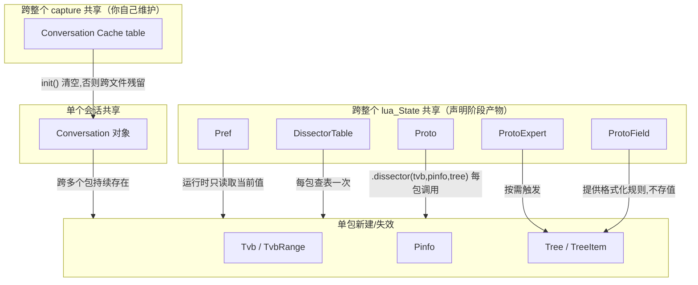

# 第五部分：Packet Runtime Mental Model — 一次 Packet 解析的数据流

## 5.1 完整数据流图

```
Raw Bytes (来自网卡/pcap 文件)
        |
        v
   Tvb (本层可见的字节视图)
        |
        v
  上游 Dissector 查 DissectorTable
        |  命中 -> 调用你的 Proto.dissector(tvb, pinfo, root)
        v
  proto.dissector(tvbuf, pktinfo, root)
        |
        +--> tvbuf:range(offset,len)         读取一段 TvbRange
        +--> pktinfo.cols.protocol:set(...)   写 Packet List 的 Protocol 列
        +--> pktinfo.cols.info:append(...)    写 Packet List 的 Info 列
        |
        v
   root:add(proto, tvbuf:range(...))  --> 返回子 TreeItem (tree)
        |
        v
   tree:add(protofield, tvbrange)  --> ProtoField 提供格式化规则 --> 渲染成一个 Tree 节点
        |
        v
   (可选) tree:add_proto_expert_info(ef)   --> Expert Info 面板
   (可选) pktinfo.conversation = proto     --> 绑定会话，后续包直连
   (可选) subdissector:call(tvb, pinfo, tree)  --> 继续往下一层转发
        |
        v
  dissector 返回本层消费的字节数 (或者不返回，代表消费了全部剩余字节)
        |
        v
--------------------- 所有普通 dissector 执行完毕 ---------------------
        |
        v
  (可选) PostDissector: 用 Field 提取器读所有已产生字段，做汇总/改列
        |
        v
  (可选) Tap/Listener: tap.packet(pinfo, tvb, tapinfo) 做统计
        |
        v
   Tree 数据固化 -> Display Filter 引擎可以对它求值
        |
        v
   GUI 渲染: Packet List (一行) + Packet Details (整棵树) + Hex View (原始字节+高亮)
```

## 5.2 五种生命周期分类

把上面出现的每一个对象，按"生命周期"重新归类，这是本部分的核心——很多 Bug（尤其是"数据串包"类）都源于对某个对象生命周期的误判。

```
+-------------------------+---------------------------------------------------+
| 分类                     | 对象举例                                             |
+-------------------------+---------------------------------------------------+
| 整个 lua_State 共用       | Proto, ProtoField, ProtoExpert, Pref,               |
| (从加载到 Reload 为止)     | DissectorTable, Field(提取器对象本身),                |
|                          | register_menu 挂的菜单函数                            |
+-------------------------+---------------------------------------------------+
| 整个 capture 文件共用      | Conversation Cache 里存的业务状态（如果你在 init()     |
| (从打开到关闭/reload 为止) | 里正确重置了）                                        |
+-------------------------+---------------------------------------------------+
| 单个 conversation 共用    | Conversation 对象本身、绑定在它上面的 dissector         |
+-------------------------+---------------------------------------------------+
| 单个 packet 新建/失效      | Tvb, TvbRange, Pinfo, TreeItem, FieldInfo(取值结果)   |
+-------------------------+---------------------------------------------------+
| 独立于以上一切、可任意持有  | ByteArray（一旦从 TvbRange 转换出来，就不再受            |
|                          | "单包"生命周期约束）                                   |
+-------------------------+---------------------------------------------------+
```

## 5.3 只读 vs 可写

```
只读（运行时不能修改，只能读取当前状态）：
  - Tvb / TvbRange 的字节内容本身（只能读，不能改包的原始数据）
  - Pinfo 里大多数字段（src/dst/port 等——虽然示例代码里演示过互换 src/dst 做测试，
    但那是 wslua 测试脚本的特殊用法，正常协议解析不应该改这些）
  - Field 提取器读到的 FieldInfo 值

可写（这是插件真正能"产生输出"的地方）：
  - Tree（每一次 :add() 都是在写）
  - pinfo.cols.*（Info/Protocol 等列文本）
  - pinfo.conversation / conversation.dissector（绑定后续行为）
  - proto.prefs.*（用户在 UI 改，脚本在 prefs_changed() 里读到新值）
  - 你自己维护的 Conversation Cache table
```

## 5.4 缓存 vs 不缓存

```
天然会被"缓存"（生命周期比单包长）：
  - Conversation 对象本身：只要这对地址端口还在通信，就一直存在
  - 你自建的 Conversation Cache table：如果自己维护良好（记得 init() 清空）

默认不缓存、每包重新计算：
  - Tvb/TvbRange 的解析结果——除非你自己存进某个表，否则下一个包不会记得上一个包解析出的字段值
  - Tree——每包都是全新的一棵树，不会跨包累积

看起来会缓存、但其实是"重新触发"：
  - Field 提取器（Field.new 返回的对象只创建一次，但每次调用它 `field()` 拿到的是
    "当前正在处理的这个包"里的值，不是历史值的缓存）
```

## 5.5 共享 vs 独占

```
所有包共享同一份（相当于"类"级别，而不是"实例"级别）：
  - Proto 对象
  - ProtoField 对象（描述字段"长什么样"的元数据，不存储任何具体的值）
  - DissectorTable 对象

每包各自独立一份（相当于"实例"）：
  - Tvb / Pinfo / Tree
  - 这次调用里创建的所有 TvbRange / TreeItem 子节点
```

这也是初学者最容易搞混的一点：**`ProtoField` 不存值**。它只是"如何展示"的规则；真正的值永远存在于某次 `tree:add(field, tvbrange)` 调用产生的那个 TreeItem 里，随这个包的 Tree 一起生（新建）灭（本包解析结束、Tree 被 GUI/输出层消费后逻辑上失效，虽然对象可能还被 Wireshark 内部保留用于重新渲染）。

## 5.6 一张图串起来



理解了"谁的生命周期是什么"之后，第六部分开始用三个真实/官方插件，把前面五部分讲的所有概念在具体代码里指认出来。
