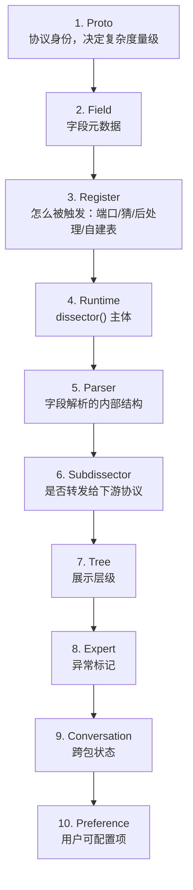
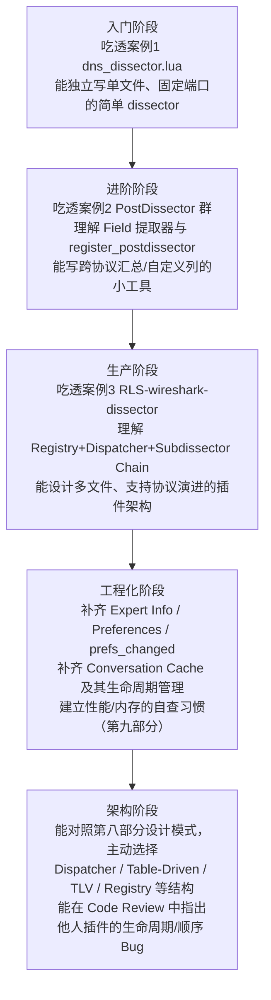

# 第十部分：最终心智模型

## 10.1 不是 API 总结，是"看代码时脑子里该跑的程序"

读完前九个部分，得到的不应该是"记住了多少个函数名"，而是一套**看到任何 Lua Plugin 源码时自动执行的检查流程**。这一部分把它写成一份可以随身带的检查清单。

## 10.2 第一眼该按什么顺序找

```
拿到一份陌生的 Lua Plugin 源码，按这个顺序扫一遍（通常 1 分钟内能扫完）：

  1. Proto        -- grep "Proto(" ，数一数有几个身份，判断是单协议还是"协议族"
                     （对照案例1 vs 案例3：1个 vs 3个，立刻能猜出复杂度级别）

  2. Field        -- grep "ProtoField" 和对应的 "proto.fields ="，
                     字段多不多、有没有位域(mask参数)、有没有值映射表

  3. Register     -- grep "DissectorTable\|register_postdissector\|register_heuristic"，
                     判断这个 Proto 是"挂靠固定端口" / "猜的(heuristic)" / "后处理的" / "自建路由表的"
                     -> 直接决定了要用第六部分哪个案例的心智模型去理解它

  4. Runtime      -- 找到 proto.dissector(tvb,pinfo,tree) 主体，
                     先看开头几行的"防御性检查"（长度够不够、magic byte 对不对），
                     再看主体的字段解析顺序，最后看结尾 return 了什么

  5. Parser       -- 有没有拆出独立的辅助解析函数？是 Table-Driven 还是手写循环？
                     有没有 TLV/Length-Prefixed/Recursive 这几种典型结构？

  6. Subdissector -- grep "Dissector.get\|:call(" ，判断它是不是链条的中间一环，
                     如果是，链条还会往下延伸到哪个协议？

  7. Tree         -- tree:add 的嵌套层级，判断 Packet Details 里会呈现出几层子树

  8. Expert       -- 有没有 ProtoExpert？覆盖了哪几类异常？severity 分级是否合理？

  9. Conversation -- 有没有跨包状态？pinfo.conversation 相关代码在哪？
                     自建的缓存表有没有对应的 init() 清空？

 10. Preference   -- proto.prefs 定义了什么？有没有配套的 prefs_changed()？
```

这十步跟第二部分"对象分类"、第四部分"基础设施速查"、第九部分"踩坑清单"是完全对应的——**读代码的顺序，就是理解这份笔记的顺序**。

## 10.3 最终心智模型图



## 10.4 三句话浓缩全文

1. **Proto 不是"写协议解析代码的地方"，而是"协议这个概念在 Wireshark 世界里的存在形式"**——一切其它对象都通过它被创建、被找到、被过滤（第一部分）。
2. **一个 Lua Plugin 的复杂度，取决于它选用了第四部分 24 项基础设施里的哪几项，而不是取决于写了多少行代码**——案例3证明了"用得少"完全可以是"架构正确"的结果，而不是"功能不全"（第四、六、九部分）。
3. **几乎所有踩坑，最终都能归结到"对某个对象生命周期的误判"或"违反了一条隐式的执行顺序约束"**——把第五部分的生命周期分类和第三部分的加载顺序规则记牢，能预防绝大多数第九部分列出的错误。

## 10.5 最终开发路线图



## 10.6 遗留问题 / 值得继续深入的方向

- 本笔记聚焦"单个/少数几个 Lua 文件构成的插件"，没有深入 Wireshark C 层 dissector 的注册机制细节（`proto_register_protocol` 等）——如果要理解"Lua API 底层到底怎么映射到 C API"，下一步应该读 `epan/wslua/wslua_proto.c` 源码（第六部分案例分析引用过其中片段）。
- Conversation 的 Lua 支持在近期版本（4.5.x）还在演进（案例1同时展示了三代写法），实际项目里应该以当前使用的 Wireshark 版本的官方文档为准，而不是死记某一种写法。
- 没有涉及"用 C 扩展模块补足 Lua API 缺口"（如社区的 `wslua_conversation` 模块），如果真实项目对 Conversation Cache 有严格的持久化/性能要求，值得进一步调研这类扩展。

---

至此，[README.md](README.md) 里画的那条学习路线（Why → Architecture → Lifecycle → Infrastructure → Runtime → Case Studies → Workflow → Patterns → Pitfalls → Mental Model）走完一圈。回到 README 检查目录，确认每一部分都能在脑子里对应起一张图或一条清单——如果可以，说明这份心智模型已经建立起来了。
