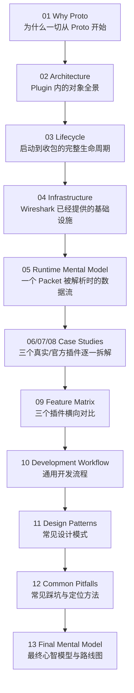

# Wireshark Lua Plugin Mental Model

一份"不教你写插件的语法，而是教你理解 Wireshark Lua Plugin 为什么这样设计"的系统性学习笔记。

## 这份笔记要解决的问题

绝大多数 Lua Plugin 教程都是从 API 开始讲："这是 `Proto`，这是 `ProtoField`，这是 `tree:add()`……"。

按这个顺序学完之后，你能改小脚本，但看到一个几千行的真实插件（多文件、Preferences、Conversation、Heuristic、Expert Info 全都用上）时仍然不知道从哪里下手看，也不知道自己设计一个新插件时该按什么顺序搭骨架。

这份笔记反过来做：先建立"为什么是这样"的心智模型，再看真实代码，最后才落到具体写法。顺序是：

```
Why  →  Architecture  →  Lifecycle  →  Infrastructure  →  Runtime
  →  Case Studies  →  Workflow  →  Patterns  →  Pitfalls  →  Mental Model
```

## 阅读路线图



## 目录

- [01-why-proto.md](01-why-proto.md) — 为什么 Lua Plugin 要围绕 `Proto` 展开
- [02-architecture.md](02-architecture.md) — 一个 Plugin 内到底有哪些对象，它们如何关联
- [03-lifecycle.md](03-lifecycle.md) — 从 Wireshark 启动到收包解析的完整生命周期（状态机）
- [04-infrastructure.md](04-infrastructure.md) — Wireshark 已经提供的基础设施速查表
- [05-runtime-mental-model.md](05-runtime-mental-model.md) — 一次 Packet 解析的数据流，谁只读/谁可写/谁缓存/谁共享
- [06-case-study-dns-dissector.md](06-case-study-dns-dissector.md) — 案例1：官方教学级 `test/lua/dissector.lua`
- [07-case-study-postdissector.md](07-case-study-postdissector.md) — 案例2：PostDissector 模式（官方 Wiki 示例）
- [08-case-study-rls-dissector.md](08-case-study-rls-dissector.md) — 案例3：真实生产插件 `RLS-wireshark-dissector`
- [09-feature-matrix.md](09-feature-matrix.md) — 三个案例的横向 Feature Matrix 与取舍
- [10-development-workflow.md](10-development-workflow.md) — 从案例反推出的通用开发流程
- [11-design-patterns.md](11-design-patterns.md) — Lua Plugin 里反复出现的设计模式
- [12-common-pitfalls.md](12-common-pitfalls.md) — 常见踩坑分类与定位方法
- [13-final-mental-model.md](13-final-mental-model.md) — 最终心智模型 + 开发路线图

## 案例速览

| 案例 | 来源 | 定位 |
|---|---|---|
| dns_dissector.lua | 官方 Wireshark 测试套件 `test/lua/dissector.lua`，作者 Hadriel Kaplan | "教学范式"：几乎覆盖所有 Lua API 类别的参考实现 |
| PostDissector 示例群 | 官方 Wiki `Lua/Dissectors`、`Lua/Examples` + 社区经典 gist | "后处理范式"：不解析 bytes，只重组/展示已有字段 |
| RLS-wireshark-dissector | 真实开源项目 `nextmn/RLS-wireshark-dissector`（UERANSIM 5G 模拟器协议） | "生产范式"：多文件、按需选基础设施、Registry+Dispatcher |

> 说明：上表用 Markdown 表格是因为内容是简单的三列对照，不涉及框图布局；正文中的架构图/状态机/数据流图仍遵循 ASCII 或 Mermaid 规范，不使用表格表达结构关系。

三个案例的完整源码都原样保存在 [code/](code/) 目录下（未做任何功能性修改，只在文件头加了来源说明），正文中引用时会给出具体行号。

## Lua 源码目录结构

```
code/
├── dns_dissector.lua                 案例1完整源码（678 行）
├── postdissector/
│   ├── 01_trivial_postdissector.lua       官方 Wiki 最小 postdissector 示例
│   ├── 02_infocolumn_swapper.lua           只改 Info 列，不建树
│   ├── 03_tree_view_menu.lua               postdissector + 菜单 + TextWindow
│   └── 04_fake_protocol_field_extractor.lua  Field 提取器 + 数值计算 + Apply as Column
├── rls/
│   ├── rls_dispatcher.lua              入口：识别版本号，转发
│   ├── rls_v3_1.lua                    子协议：3.1.x 版本实现
│   └── rls_v3_2.lua                    子协议：3.2.x 版本实现
└── patterns/                          第八部分设计模式的独立教学示例（非真实项目代码）
    ├── conversation_cache.lua              （不属于12个模式，被04/12章节引用）
    ├── dispatcher/            example1.lua（数值分派） example2.lua（字符串命令分派）
    ├── parser_function/       example1.lua（多值返回） example2.lua（可复用变长字段解析）
    ├── table_driven/          example1.lua（固定顺序字段表） example2.lua（表项带decode函数）
    ├── subdissector_chain/    example1.lua（转发给ip） example2.lua（多目标转发+回退）
    ├── offset_walker/         example1.lua（基础Cursor） example2.lua（peek/skip前瞻）
    ├── length_prefixed/       example1.lua（单个长度前缀） example2.lua（重复长度前缀数组）
    ├── tlv_parser/            example1.lua（扁平TLV） example2.lua（嵌套TLV，递归）
    ├── recursive_parser/      example1.lua（循环模拟递归） example2.lua（真递归，树形结构）
    ├── factory/               example1.lua（批量生成版本化Proto） example2.lua（批量生成ProtoField）
    ├── registry/              entry.lua+v1.lua+v2.lua（DissectorTable注册表） example2.lua（轻量注册表）
    ├── expert_info/           example1.lua（单类别ProtoExpert） example2.lua（多类别分级）
    └── lazy_decode/           example1.lua（allfields=false） example2.lua（allfields=true对比）
```

## 参考资料

- Wireshark Developer's Guide — Lua 支持：<https://www.wireshark.org/docs/wsdg_html_chunked/wsluarm.html>
- Functions For New Protocols And Dissectors（`Proto` 章节）：<https://www.wireshark.org/docs/wsdg_html_chunked/lua_module_Proto.html>
- Wireshark's Lua API Reference Manual：<https://www.wireshark.org/docs/wsdg_html_chunked/wsluarm_modules.html>
- 官方 Wiki — Lua：<https://wiki.wireshark.org/Lua>
- 官方 Wiki — Lua/Dissectors（postdissector 章节）：<https://wiki.wireshark.org/lua/dissectors>
- 官方 Wiki — Lua/Examples：<https://wiki.wireshark.org/Lua/Examples>
- 案例1源码：<https://github.com/wireshark/wireshark/blob/master/test/lua/dissector.lua>
- 案例3源码：<https://github.com/nextmn/RLS-wireshark-dissector>
- 相关笔记：[Wireshark 解析 Packet 的通用流程与心智模型](../../wireshark_parser_flow.md)、[wireshark/fsm/](../fsm/README.md)（Wireshark 内部 FSM 实现分析）
