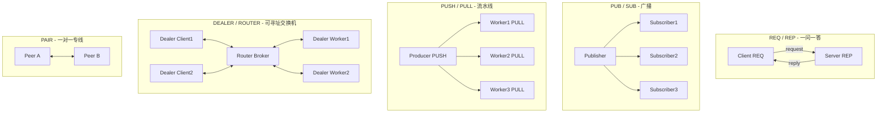
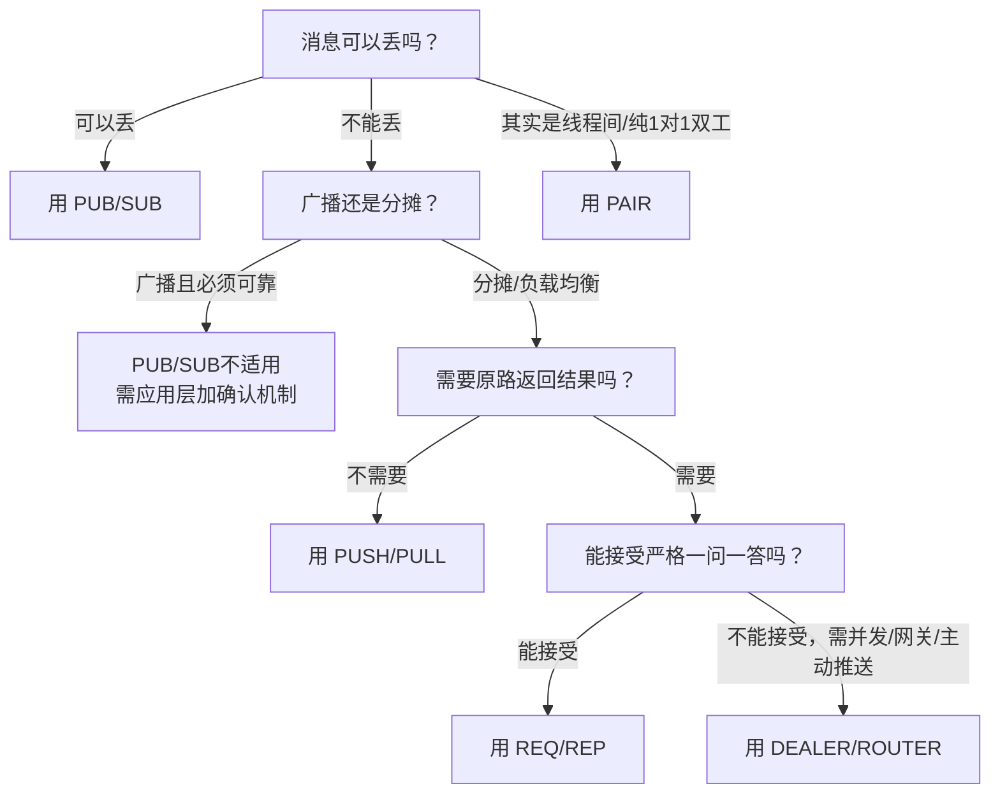

# ZMQ Pattern 总结：适用场景与心智模型

看完 [01_req_rep](01_req_rep/) ~ [05_pair](05_pair/) 的 15 个示例后，回到最初的问题：**什么场景该用哪个 pattern？** 这份总结把 5 种 pattern 横向摆在一起对比。

---

## 一张表看懂 5 种 Pattern

| Pattern | 拓扑关系 | 是否有序/严格交替 | 是否会丢消息 | 心智模型比喻 | 典型场景 |
|---|---|---|---|---|---|
| REQ / REP | 1 对 1（逻辑上） | 严格交替，必须一问一答 | 不丢（阻塞等待） | 打电话问答 / RPC | 同步调用、简单服务接口 |
| PUB / SUB | 1 对 N（广播） | 无序，各自独立 | **会丢**（无缓冲重放，慢订阅者丢消息） | 微信群广播 | 行情推送、日志广播、配置变更通知 |
| PUSH / PULL | 1 对 N 或 N 对 1（流水线） | 无序，自动负载均衡 | 不丢（队满则阻塞） | 工厂流水线 | 任务分发、批处理、日志聚合 |
| DEALER / ROUTER | N 对 N（可寻址） | 无序，无阻塞限制 | 不丢（阻塞或按HWM） | 交换机 / 支持并发的柜台 | 异步RPC、Broker网关、按身份主动推送 |
| PAIR | 1 对 1（严格） | 无序，完全对等 | 不丢（阻塞） | 对讲机 / 专线电话 | 线程间控制、简单双工通道 |

---

## 拓扑关系图

---

## 选择 Pattern 的决策思路

按下面的问题顺序问自己，基本就能定下来用哪个 pattern：

1. **消息可以丢吗？**
   - 可以丢（比如只关心最新数据，丢一条无所谓）-> 优先考虑 **PUB/SUB**。
   - 不能丢 -> 排除 PUB/SUB，继续往下看。

2. **是广播（所有人都要收到同一条），还是分摊（每条消息只需要一个人处理）？**
   - 广播 -> **PUB/SUB**（如果能接受丢消息）；如果不能丢，需要在应用层自己加确认/重传机制，或考虑用多个 PUSH/PULL 通道模拟。
   - 分摊/负载均衡 -> **PUSH/PULL**。

3. **需不需要"处理完之后把结果原路送回发起者"？**
   - 不需要（比如流水线最后统一汇总，不用管是谁发的）-> **PUSH/PULL** 足够。
   - 需要（谁发的请求，处理完必须准确地回给谁）-> 进入 REQ/REP 或 DEALER/ROUTER 的范畴。

4. **请求-响应模式下，客户端能接受"发一个等一个"的严格顺序吗？**
   - 能接受，逻辑简单 -> **REQ/REP**（最简单，自带状态机保护，不容易出 bug）。
   - 不能接受（需要并发发多个请求、需要中转/网关、需要服务端主动推送）-> **DEALER/ROUTER**。

5. **是不是同一进程内的线程通信，或者纯粹两个节点间的一对一双工通道，且不需要负载均衡/多连接？**
   - 是 -> **PAIR**（最简单直接，双方对等，无需考虑消息顺序）。

---

## 每种 Pattern 一句话心智模型（复习）

- **REQ/REP**：打电话——你问一句，对方答一句，不能同时说话，也不能连续问两句。
- **PUB/SUB**：广播站——电台不知道谁在听，听众自己选频道，错过了就是错过了。
- **PUSH/PULL**：传送带——东西放上去，谁有空谁拿，拿慢了东西会堆积但不会掉地上。
- **DEALER/ROUTER**：总机交换台——总机知道每条线是谁，可以随时主动呼叫任何一条线，任何一条线也能同时占线好几个通话。
- **PAIR**：对讲机——买一对，两边地位完全一样，谁想说话随时按下发送键。

---

## 常见误用速查

| 误用场景 | 后果 | 正确做法 |
|---|---|---|
| 用 REQ/REP 做高频广播 | 客户端要一个个轮询，效率极低 | 换 PUB/SUB |
| 用 PUB/SUB 传输"绝对不能丢"的指令 | 网络抖动/订阅者慢，指令悄悄丢失 | 换 REQ/REP 或 DEALER/ROUTER，加确认机制 |
| REQ socket 超时后继续用同一个 socket 重试 | 状态机错乱，行为不可预期 | 关闭旧 socket、创建新的 REQ socket（[Lazy Pirate](01_req_rep/example3_lazy_pirate_reliable/)） |
| 想用 PAIR 连接 3 个以上节点 | PAIR 只支持1对1，新连接会顶替旧连接 | 换 ROUTER（服务端可管理多个身份）或 PUB/SUB |
| 用 PUSH/PULL 但期望"服务端主动推送结果给特定客户端" | PUSH/PULL 无法按身份寻址，做不到 | 换 DEALER/ROUTER（[身份推送示例](04_dealer_router/example3_identity_push/)） |

---

## 延伸阅读

- 回到 [zmq_mental_model.md](../zmq_mental_model.md) 复习 Context / Socket / Message 三层心智模型，以及 HWM、bind/connect、Transport 等基础概念。
- 每个 pattern 目录下的 `README.md` 都有更详细的"什么场景用/不该用"说明，可以按需深入某一个。
